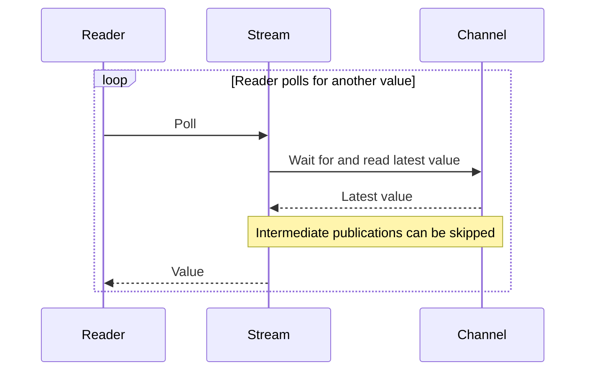

# Markdown examples

These fictional examples illustrate structure. Their commands and behavior do not establish project requirements.

## Independent rules

Incorrect: separate source lines still render as one paragraph.

```markdown
Use the committed lockfile.
Keep credentials out of commits.
```

Correct: each obligation can be checked separately.

```markdown
* Use the committed lockfile.
* Keep credentials out of commits.
```

## Ordered procedure

Use numbered steps when later actions depend on earlier results. Indent commands and results under their step.

````markdown
1. Start the example server.

   ```powershell
   ./example-server.ps1
   ```

2. Request `/health`.
3. Check that the response status is `200`.
````

## Conditions and alternatives

| Situation | Form |
| --- | --- |
| One condition qualifies one instruction | Keep the condition in that instruction |
| Different conditions select alternative actions | Use a decision table |
| Several obligations apply independently | Use bullets, even when individual obligations have conditions |

One conditional instruction:

```markdown
* If a proxy is introduced, test its streaming settings.
```

Alternative actions:

```markdown
| Request | Action |
| --- | --- |
| Review only | Report findings without editing. |
| Authorized rewrite | Apply corrections and check the result. |
```

## Meaning across table rows

Source: “Cancellation signals both workers. Normal shutdown also joins their tasks.”

Incorrect: the second row loses the shared signalling requirement.

```markdown
| Mode | Behavior |
| --- | --- |
| Cancellation | Signal both workers. |
| Normal shutdown | Join their tasks. |
```

Correct: each row retains its complete behavior.

```markdown
| Mode | Behavior |
| --- | --- |
| Cancellation | Signal both workers. |
| Normal shutdown | Signal both workers and join their tasks. |
```

Use “then” only when the source establishes that order. Otherwise, retain “and”.

## Connected explanation

Keep a mechanism and its consequence in one paragraph. Do not combine independent obligations, findings, results, or limitations merely because they share a topic.

```markdown
The channel retains only the newest value. A slow reader can therefore skip intermediate publications.
```

Do not split this explanation merely because it contains two sentences.

## PR validation results

Incorrect: one paragraph combines separate checks and evidence limits.

```markdown
Local links and Markdown structure were checked. Two agent trials preserved the required wording. One trial omitted a termination branch. Mermaid was not rendered. Application tests were not run because only documentation changed.
```

Correct: group each result with its qualifications using common fields.

```markdown
| Check | Result and limitation |
| --- | --- |
| Documentation | Local links and Markdown structure were checked. Mermaid was not rendered. |
| Agent trials | Two trials preserved the required wording. One omitted a termination branch, so the trials do not establish complete diagram accuracy. |
| Application tests | Not run because only documentation changed. |
```

* Use grouped bullets instead when the entries do not share useful fields.
* Keep a result and its explanation or qualification in the same item or row.
* Put exclusions from the PR in its scope description, not among validation results.
* Preserve a connected explanation as prose; do not turn every sentence into a separate item.
* Copy the structure, not the fictional results. Report only checks supported by the actual task evidence.

## Heading scope

Incorrect: a new subheading makes a general evidence limit appear specific to cancellation.

```markdown
## Desktop checks

### Cancellation

* Check that the connection closes.

> Desktop checks do not establish phone compatibility.
```

Correct: the general limit precedes the narrower subsection.

```markdown
## Desktop checks

> Desktop checks do not establish phone compatibility.

### Cancellation

* Check that the connection closes.
```

## Diagram scope

| Content | Form |
| --- | --- |
| A short PR sentence: “The browser receives server updates.” | Keep the sentence; no diagram is required |
| A description of interactions among a reader, stream, and channel | Use a sequence diagram with the relevant conditions |
| A procedure for starting and checking a server | Use numbered steps; their order alone does not require a sequence diagram |

In this fictional contract, the stream reads the latest value only when polled. Intermediate publications can be skipped.

Incorrect diagram label: `loop Every publication` implies delivery of every value.

Correct source:

````markdown

````

* Retain the polling and skipped-publication limits in surrounding text.
* Check the rendered diagram separately from the surrounding Markdown.
* If rendering is unavailable, report that limitation; do not claim visual validation.
