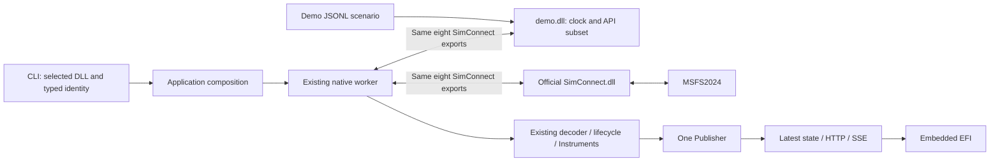

# Proposed ADR: JSONL Demo behind the SimConnect DLL boundary

Decision status: Proposed technical architecture. Product direction follows the explicit discussion decisions recorded in [the local index](README.md#discussion-decisions).

The durable ADR number must be selected against the current repository at implementation.
This local draft does not overwrite the accepted #91 comment or reserve ADR 0010.

## Context

### Receive-path clarification after the Astra review

The accepted requirement is to adapt Demo to SimConnect behavior whenever the two differ.
The following implementation remains proposed. The frozen Astra review predates this clarification.

Recommend one internal scheduler thread, a receive queue, and one separately retained dispatch packet per connection.
The application uses its existing native receive loop with either DLL.
The scheduler represents the synthetic simulator and prepares requested packets independently of calls to GetNextDispatch.
It signals the Windows event supplied to Open after making packets available.
GetNextDispatch returns the next prepared packet. It does not advance the scenario or calculate a replacement observation.

```mermaid
sequenceDiagram
    participant D as demo.dll
    participant A as Application
    A->>D: Open with notification event
    D-->>A: Connection handle and HRESULT
    A->>D: Define data, subscribe, request observations
    D-->>A: HRESULT for each call
    Note over D: Scheduler advances JSONL timeline independently
    D->>D: Create packet and append to receive queue
    D-->>A: Signal notification event
    Note over A: Existing worker wakes
    A->>D: GetNextDispatch
    D->>D: Move next queued packet into retained dispatch slot
    D-->>A: Packet pointer and byte length
    Note over A: Decode and copy into owned values
    Note over D: Scheduler can append other packets without changing returned bytes
    A->>D: GetNextDispatch again
    D-->>A: Next packet or empty-queue result
    A->>D: Close
    D->>D: Stop and join scheduler; release connection memory
    D-->>A: Success
```

The receive queue owns packets waiting for collection.
The dispatch slot owns the packet currently exposed to the caller.
Moving a packet into that slot need not copy its bytes.
The scheduler never changes or frees the exposed allocation.
The pointer remains readable and unchanged until the next GetNextDispatch on that connection or Close.
This is the proposed Demo memory contract, not a newly verified SDK lifetime guarantee.

Use a short lock for connection state and queue operations.
Do not hold that lock while the application decodes data or while Close joins the scheduler.
Signal after enqueueing. Notifications can coalesce, so their count is not a packet count.
When dispatch leaves packets pending, preserve a wake opportunity for the application's bounded drain loop.
Demo borrows the application's notification handle and stops using it before successful Close returns.

| Alternative | Assessment |
| --- | --- |
| Calculate observations only when GetNextDispatch runs | Rejected: hides asynchronous arrival and depends on application polling |
| Scheduler, receive queue, retained dispatch packet | Recommended: exercises arrival, notification, dispatch, and concurrent memory ownership |
| Separate simulator process or full SimConnect reimplementation | No demonstrated need for the currently used API surface |

### Fidelity rules and remaining evidence

* Match externally observable behavior for the API used by this application. Internal Microsoft thread and allocation details are not known or required.
* Preserve requested names, units, types, field order, IDs, request periods, subscriptions, query replies, and exception correlation.
* Match the current SIM_FRAME request with flags 0: emit unchanged values on due frames, keep emitting during hold, and suppress only the specified signal during gap.
* Do not make emission conditional on numeric changes or GetNextDispatch frequency. Repeated equal observations refresh server acquisition time.
* Keep immediate HRESULT failures distinct from later exception packets. Determine which channel each normal API error uses from authoritative evidence.
* Treat deliberate malformed-packet injection as robustness testing. It is not evidence that the official DLL emits those packets.
* Start the scenario timeline at the first successful Open and retain its origin across reconnects. This is a proposed scenario convention, independent of dispatch.
* Keep that clock continuously increasing through pauses, reconnects, and subsequent passes through the scenario.
* After the last step, execute the first step again at its next absolute deadline. Looping changes the playback cursor, not the clock or lifecycle state.
* Demo DLL only plays scenario instructions. Apply scenario-authored initial state once; subsequent pause and flight changes require explicit scenario records.
* Do not synthesize a state reset, resume, or flight activation at the file boundary. There is no finite-end waiting mode.
* Allow registration to overlap scenario time. Use an authored initial hold when a scenario needs setup time; do not wait for private knowledge of the application's final registration.
* Keep queued packet contents unchanged. Slow consumption must not cause Demo to replace old values with current values to conceal a receiver problem.
* Confirm queue overflow behavior, empty-queue results, pause-time delivery, and asynchronous error details before claiming equivalence for those cases.

The SDK documents a receive queue, library-owned packet memory, and retrieval without a callback in [GetNextDispatch](https://docs.flightsimulator.com/msfs2024/retail/programming-apis/simconnect/api-reference/general/simconnect_getnextdispatch/).
Its empty-queue remarks mention SIMCONNECT_RECV_ID_NULL; the current receiver also treats E_FAIL as empty.
Resolve that distinction against the targeted runtime instead of making the emulator validate only the receiver's assumption.
The [Open contract](https://docs.flightsimulator.com/msfs2024/retail/programming-apis/simconnect/api-reference/general/simconnect_open/) provides the Windows notification handle.
The [request contract](https://docs.flightsimulator.com/msfs2024/retail/programming-apis/simconnect/api-reference/events-and-data/simconnect_requestdataonsimobject/) defines delivery periods and caller request IDs.

Later verification must compare the same small native client against both DLLs.
Check notification-driven receipt without relying on the application's 50 ms timeout, queue draining, retained memory, errors, and Close.
Differences update Demo; a demonstrated application defect requires a separate explicit finding rather than an emulator workaround.
No such runtime comparison, test, or diagram rendering was performed during this static clarification.

This clarification changes S2's contract work, S3's scheduler and dispatch acceptance, S5's error mapping, and S8's startup expectations.
S6 relates input values to output evidence without rewriting or dropping already queued packets to improve application freshness.
The previous first-dispatch clock and dispatch-time value refresh are superseded proposals.
The historical review records and frozen review input remain unchanged.

The current Demo publishes normalized FlightSample values directly.
It exercises the Publisher-to-EFI path but bypasses the application's SimConnect loading, registration, dispatch, native conventions, and lifecycle acquisition.

The original [Task #91](https://github.com/LeszekKantorek/msfs2024-artificial-horizon/issues/91) specified editable scenarios and recorded-session conversion. The latest discussion retains authoring and removes conversion, requiring forward scenario-to-output verification instead.
Its accepted comment selects YAML containing complete normalized telemetry events.
The current discussion changes that boundary to a DLL that acts as the used SimConnect API.

The revised scope includes JSONL hold/ramp instructions, the DLL's own clock, API failures, malformed packets, and flight/pause states.
It also includes a flight narrative, focused availability/lifecycle scenarios, and isolated potentially terminating failures.
The Demo supports the real consumer's field subset. It does not invent SimVars for fictional presentation values.

## Decision

Retain the root application package and add one workspace package that produces a Windows x64 Rust cdylib named `demo.dll`.
Both DLL selections feed the existing SimConnect receiver.



The diagram shows alternative DLL selections, not two simultaneous connections.
Only one receiver and one active publisher run.
A Demo-only setup export selects and validates scenario data; it does not publish telemetry.

## Responsibilities

| Owner | Responsibility |
| --- | --- |
| CLI | Parse DLL selection, scenario path, log path, HTTP settings, and process shutdown |
| Application | Fix Demo or SimConnect identity, bind HTTP, start one receiver, and supervise shutdown |
| Existing native provider | Load selected DLL, configure requests, decode, normalize, enforce lifecycle/freshness, and publish |
| Demo DLL | Own scenario data, clock, request/definition tables, API results, receive memory, notification producer, and injected faults |
| Scenario | Describe native inputs and durations; ordinary content does not dictate client request IDs or packed layouts |
| Acceptance evidence | Relate scenario inputs and existing normalization to observed log/SSE results |
| HTTP and EFI | Keep their present interfaces and behavior |

No provider registry, alternate HTTP endpoint, browser scenario control, or second normalization pipeline is required.

## CLI and identity

Accepted selection supports two filenames, case insensitive (for example DEMO.dll and SIMCONNECT.DLL). Export names retain their exact native spelling:

* A bare `demo.dll` or `SimConnect.dll` resolves beside the running EXE.
* An absolute path retains that supported basename and selects exactly that file.
* Reject relative paths containing directories, unknown basenames, legacy `--source demo|simconnect`, and `--dll`.
* Preserve simulator-free default startup by selecting adjacent `demo.dll` when `--source` is omitted.
* Accept `--scenario <path>` only for Demo. Resolve an explicit relative scenario path against the caller's working directory.
* Retain optional exact-file `--log` diagnostics for the common receiver in either mode.

Typed selection records Demo or SimConnect before channel creation.
Filename recognition selects semantics; it does not authenticate a DLL.
No identity export or generic third-party plugin interface is needed.

Example target commands:

```powershell
msfs2024-artificial-horizon.exe --source demo.dll
msfs2024-artificial-horizon.exe --source demo.dll --scenario .\scenarios\pause.jsonl
msfs2024-artificial-horizon.exe --source "C:\runtime\SimConnect.dll"
```

These commands describe proposed behavior and were not executed.

## Scenario model

Use one validated JSONL document with a required header and typed records.
Support named signal tracks containing sequential hold, ramp, and gap segments.
Tracks run together; their individual repeats preserve existing independent Demo cycles.

Keep lifecycle events and fault rules explicit.
Scenarios can provide all signals, a selected subset, lifecycle events only, or no signal values.
Supported native registration is independent of scenario coverage; absent values produce no observations and no implicit zero samples.
Demo remains a playback mechanism. Unreceived instrument values default to null/unavailable throughout the application; never substitute zero.
Preserve existing SSE omission of absent optional fields and current lifecycle gates.
Authored holds, ramps, gaps, and events supply the native input; recorded-session playback is outside this Task.
Every completed pass returns to the first step on the same increasing clock, with no implicit lifecycle changes.

JSONL is the selected serialization. The scenario schema differs from the diagnostic log schema.
Verification follows scenario input to result; no conversion between these schemas is required.

[The contract draft](contracts.md) defines the proposed records and timing.

### Scenario suite and ownership

Keep the mapped default/boundary scenario in `demo_scenario.jsonl`.
Add explicit selections under `demo-scenarios/`, including a narrated flight and focused error files.
This addition does not silently replace the agreed default or its boundary assertions.

Use `docs/sources/demo-scenarios.md` as a purpose-only catalog linked from the Demo source guide.
JSONL remains authoritative for values, durations, event order, and fault parameters.
The catalog contains assumptions, covered behavior, expected completion, and links; it does not duplicate the scenario.

The flight narrative uses existing native signals and includes recoverable simulator availability and both pause modes.
Permanent producer failures belong in separate scenarios because later narrative phases cannot run after source termination.
Host/HTTP failures use launch or harness conditions rather than invented SimConnect records.

No Vx, stall-warning, ground-contact input, or flight dynamics is added.
Those narrative labels describe the intended visible progression of fictional native values.

## Alternatives

| Option | Benefit | Cost or unmet requirement | Assessment |
| --- | --- | --- | --- |
| Retain direct Demo and add unit mocks | Least runtime change | Does not exercise DLL exports, real native dispatch, or registration agreement | Does not meet the requested boundary |
| Keep direct Demo plus a separate DLL test source | Preserves fictional full profiles | Retains two Demo paths and does not make normal Demo exercise the native receiver | Not recommended |
| Replace the entire provider with a project plugin ABI | Uniform external providers | Requires an official-DLL wrapper and tests a new ABI rather than the current consumer directly | Reject |
| SimConnect-compatible Demo DLL | Reuses actual receiver and official runtime directly | Requires a cdylib, scenario setup, independent modeled API, and artifact delivery | Recommend |
| Add cdylib to the entire root library | Avoids a workspace member | Couples HTTP/application dependencies to Demo and complicates DLL naming and separation | Viable but less focused |
| Focused workspace cdylib | Keeps synthetic source implementation separate | Changes current single-package policy and build commands | Recommend for this concrete second artifact |
| YAML scenario | Comments and convenient multiline authoring | Additional parsing behavior; no longer selected by the discussion | Superseded locally |
| One JSON scenario object | Simple nested representation | Does not satisfy the selected record-per-line authoring model | Not selected |
| JSONL scenario | One instruction per line; existing JSON stack | No comments or pretty-printed multiline records | Selected by the discussion |

## Accepted invariants

* Keep Windows x64 MSVC, MIT licensing, SDK-free default builds, and runtime loading of the official DLL.
* Preserve one process, one selected receiver, one active publisher, latest-state distribution, and independent optional availability.
* Keep the current normalization, IAS estimator, telemetry wire fields, and browser module responsibilities.
* Keep snapshot-time expiry and maintenance during silent periods.
* Bind HTTP before native acquisition. Producer failure leaves HTTP serving unavailable state.
* Never fall back to Demo after live-source failure.
* Close and join native work before successful teardown. Keep the existing failed-close retain-mapping behavior.
* Deliver the complete application and Demo DLL together after changes to code or build inputs.

## Explicit amendments

| Earlier source | Revised portion | Preserved portion |
| --- | --- | --- |
| ADR 0006 | Permit project-owned Demo cdylib; both modes use runtime loading; selection is a DLL path | Manual minimal FFI, single native owner, secure search, cleanup, official SDK distribution limits |
| ADR 0007 | Source selection chooses identity/configuration for one shared native receiver | HTTP-first startup, one publisher, source-failure isolation, coordinated shutdown |
| Architecture single-package guidance | Add one justified workspace member for Demo DLL | No framework, service split, SDK build dependency, or Cargo feature selection |
| #91 accepted comment / planned ADR 0010 | JSONL instructions replace YAML snapshots; DLL owns playback; recorded-session conversion is withdrawn | Editable external data, embedded default, independent expectations, no silent fallback |
| #91 full Demo equivalence | Preserve mapped scenario values and phases; unsupported fictional profile values stay absent | Existing presentation fixtures can still test their accepted values separately |
| #91 clock/publication assertions | Verify scenario inputs through new native receipt times | Continuous clock, ordered events, gaps, and independent output expectations |
| #123–#126 | Require explicit replanning before execution under the new architecture | Preserve their history, original instructions, and useful mapping evidence |

A visible Demo badge, new recording protocol, changed estimator, and official DLL redistribution remain outside this Task.

## Consequences and unresolved evidence

* Default delivery becomes EXE plus project-owned demo.dll. The embedded default remains inside demo.dll.
* Missing DLL, scenario setup, or parser errors occur in the source path after HTTP binding. They leave HTTP available and report actionable source errors.
* This deliberately replaces the earlier planned requirement that scenario parsing fail before HTTP binds.
* Raw SimConnect packets have no original replay acquisition timestamp. The receiver assigns new receipt times.
* Exact historical ages, estimator values, publication counts, and original painted frames cannot be promised through this unchanged ABI.
* Existing diagnostics are evidence of their documented stage; capture SSE separately when the log lacks final output.
* Recorded-session conversion and schema 4/5 import support are removed from #91, not deferred prerequisites.

## Validation and reconsideration

Later implementation requires DLL ABI/registration checks, independent names and values, real DLL loading, scenario timing/lifecycle tests, fault tests, application checks, and compiled EFI captures.
No such checks were run during planning.

Reconsider this design if required replay fidelity demands original timestamps unavailable through the native ABI.
That requirement would require a separate decision rather than hidden timestamp extensions or a second publication path.

Reconsider filename restrictions only when a concrete requirement needs renamed third-party DLLs.
Reconsider additional packages only when a demonstrated ownership boundary needs them.
