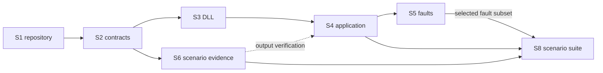

# Deliver the revised Task #91

Status: Local Subtask drafts. Publication, execution, and existing-issue changes remain unauthorized.

## Assignments and dependencies

Planning and consultation use GPT-6.1 Sol at medium.
Implementation defaults to one GPT-6.1 Terra developer at medium.
Independent review remains separate from authorship.
Follow the [task, test, and review execution plan](tasks-tests-review.md). Each review checks both its own outcome and the prerequisites supplied to its next consumer; S1, S2, and S3 carry explicit reviewer instructions in their first context comments.
This session used Sol subagents for analysis; it did not execute a Terra assignment.

| ID | Draft outcome | Kind | Prerequisites |
| --- | --- | --- | --- |
| S1 | [Prepare the workspace and coordinated artifact build](subtasks/S1-repository.md) | Repository first | Architecture direction accepted; no prerequisite Subtask |
| S2 | [Record the revised contracts and decision](subtasks/S2-documentation.md) | Documentation | S1; discussion amendments accepted |
| S3 | [Build the healthy JSONL SimConnect Demo DLL](subtasks/S3-demo-dll.md) | Code | S2 |
| S4 | [Select either DLL through the common application receiver](subtasks/S4-application.md) | Code and current usage | S3; S6 mapping before output verification |
| S5 | [Add API and packet fault scenarios](subtasks/S5-faults.md) | Code | S4 |
| S6 | [Establish scenario-to-output evidence](subtasks/S6-scenario-evidence.md) | Bounded evidence mapping | S2; S4 supplies integrated evidence |
| S8 | [Deliver narrated flight and focused scenario suite](subtasks/S8-scenario-suite.md) | Scenario data, integration tests, and catalog | S4, S6 mapping, and the selected S5 fault subset |

S1 changes repository structure before functional source changes.
The playback rule is settled: the clock always advances and the last step is followed by the first step of another pass.
S2 documents that rule; S3 implements it; S6 maps input to expected output; S8 authors explicit lifecycle changes.
No Subtask is assigned to restore initial state or reset time at a pass boundary.
S2 promotes documentation before dependent implementation.
S3–S5 deliver the common native path and requested lifecycle/fault behavior.
S6 may establish its result without code, a PR, or project execution.
S8 adds the explicitly requested multi-scenario outcome; it does not replace routine unit/boundary testing with one long narrative.
No parallel developers are proposed.



## Existing Subtasks

Do not execute #123–#126 unchanged against this proposal.
Their current YAML/normalized-publication instructions conflict with the revised boundary.

| Existing issue | Useful retained intent | Required future treatment |
| --- | --- | --- |
| #123 | External scenario data; default scenario migration | Replace YAML/full snapshot ownership with the selected JSONL/native-instruction contract after publication is authorized |
| #124 | Selection, timing, application integration, shared clients | Replan around DLL selection and the common receiver |
| #125 | Historical conversion evidence | Preserve its completed mapping/history; conversion is removed from active #91 scope |
| #126 | Historical converter assignment | No converter delivery remains in #91; refresh issue state before an authorized disposition, without rewriting historical results |

These are proposed dispositions, not instructions to edit historical records automatically.
Before publication, refresh complete bodies, comments, artifacts, relationships, and any execution results.
Choose whether to amend open children or create replacements only under explicit authorization.

## Repository changes

Recommended target layout:

```text
Cargo.toml                       existing application package plus workspace
crates/demo/Cargo.toml            focused project-owned cdylib package
crates/demo/src/                  JSONL reader, timeline, ABI subset, native encoding
demo_scenario.jsonl               compact default instructions, embedded into demo.dll
demo-scenarios/                   narrated flight, lifecycle, availability, and isolated faults
docs/sources/demo-scenarios.md    purpose-only catalog; JSONL owns the scenario details
tests/fixtures/demo/              synthetic scenarios and independent expected observations
src/providers/simconnect/         current shared receiver
src/application.rs               typed DLL identity and configuration
src/bin/main.rs                   DLL-path source selection

```

Use existing focused source files where possible.
Do not add a shared SDK crate, provider registry, installer, generic release pipeline, or new GitHub build workflow.

## Acceptance coverage

| Requirement | Owning outcome and later evidence |
| --- | --- |
| EXE and Demo DLL built without SDK | S1: Windows workspace builds and artifact identities |
| Compact JSONL and 5-second hold/ramp | S3: controlled clock checkpoints plus actual DLL loading |
| All used signals, units, indexes, IDs, diagnostic shape | S2/S3: independent catalog and registration tests |
| Normal/active pause and active/inactive flight | S3/S4: native events, query state, stale/waiting/paused/live recovery |
| Same native acquisition path | S4: default/explicit selection through real loader and SSE |
| API failures and malformed packets | S5: deterministic scenarios, memory-safe test buffers, source-failure isolation |
| Additional existing native errors | S5: explicit source/HTTP/application outcomes; host failures use harness conditions |
| Flight tour and multiple focused scenarios | S8: coherent progression, both pauses, simulator availability, and isolated terminal failures |
| Scenario documentation without duplication | S2 establishes ownership; S8 verifies catalog links/purposes against committed files |
| Scenario-to-output verification | S6 defines independent input/output mapping; S4/S8 verify actual log/SSE results |
| EFI presentation capability preserved | S4: retained independent fixtures; narrower source output explicitly distinguished |
| Complete application delivery | Each code/build outcome: coordinated checks/build; final integrated EXE plus demo.dll |

## Validation instructions for later implementation

The current static-only restriction applies to this planning session.
The commands below are proposed later checks, not reported results or authorization to run them now.

Use Windows x64 MSVC and the current validation matrix.
After S1, use workspace-wide variants where appropriate:

```powershell
$env:RUSTUP_TOOLCHAIN = 'stable'
$env:CARGO_BUILD_TARGET = 'x86_64-pc-windows-msvc'
cargo fmt --all -- --check
cargo clippy --workspace --locked --all-targets -- -D warnings
cargo build --workspace --locked
cargo test --workspace --locked --all-targets
node --test tests/*.test.mjs
cargo build --workspace --locked --release
```

The preliminary debug build supplies the DLL for loader integration tests.
It does not replace the final complete release build.
Ensure tests select its explicit absolute path rather than assuming the DLL sits beside a hashed test executable.

Consolidate screenshot-producing browser checks and visual inspection into S8's single integrated session against the complete release delivery, as explicitly requested. Do not repeat them after S1-S6 or require visual approval at each handoff.
S4 updates the scripts' old CLI assumptions; S8 runs the applicable scripts and inspects representative matched captures under the [visual verification schedule](tasks-tests-review.md#visual-verification-schedule). Earlier handoffs retain visual acceptance as pending.
Use controlled scheduler tests for precise timing; real thread scheduling supports bounded timing evidence rather than exact timestamps.

Record the revision, local changes, commands, environment, EXE and DLL hashes, scenario identity, observed outputs, review, and missing checks.
Do not add builds/tests to GitHub Actions.
No current acceptance checkbox is marked complete by this plan.

## Removed converter assignment

The latest explicit decision removes recorded-flight conversion from #91. S7 is removed, not deferred. S6 now establishes forward scenario-to-output evidence. Original issue records and frozen reviews remain historical sources.
