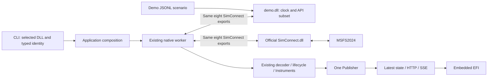

# Proposed ADR: JSONL Demo behind the SimConnect DLL boundary

Decision status: Proposed technical architecture. Product direction follows the explicit discussion decisions recorded in [the local index](README.md#discussion-decisions).

The durable ADR number must be selected against the current repository at implementation.
This local draft does not overwrite the accepted #91 comment or reserve ADR 0010.

## Context

The current Demo publishes normalized FlightSample values directly.
It exercises the Publisher-to-EFI path but bypasses the application's SimConnect loading, registration, dispatch, native conventions, and lifecycle acquisition.

[Task #91](https://github.com/LeszekKantorek/msfs2024-artificial-horizon/issues/91) already specifies editable scenarios and recorded-session conversion.
Its accepted comment selects YAML containing complete normalized telemetry events.
The current discussion changes that boundary to a DLL that acts as the used SimConnect API.

The revised scope includes JSONL hold/ramp instructions, the DLL's own clock, API failures, malformed packets, and flight/pause states.
It also includes a flight narrative, focused availability/lifecycle scenarios, and isolated potentially terminating failures.
The Demo supports the real consumer's field subset. It does not invent SimVars for fictional presentation values.

## Decision

Retain the root application package and add one workspace package that produces a Windows x64 Rust cdylib named `demo.dll`.
Both DLL selections feed the existing SimConnect receiver.



The diagram shows alternative DLL selections, not two simultaneous connections.
Only one receiver and one active publisher run.
A Demo-only setup export selects and validates scenario data; it does not publish telemetry.

## Responsibilities

| Owner | Responsibility |
| --- | --- |
| CLI | Parse DLL selection, scenario path, log path, HTTP settings, and process shutdown |
| Application | Fix Demo or SimConnect identity, bind HTTP, start one receiver, and supervise shutdown |
| Existing native provider | Load selected DLL, configure requests, decode, normalize, enforce lifecycle/freshness, and publish |
| Demo DLL | Own scenario data, clock, request/definition tables, API results, receive memory, notification producer, and injected faults |
| Scenario | Describe native inputs and durations; ordinary content does not dictate client request IDs or packed layouts |
| Offline converter | Extract one recorded session into the same scenario format; report fidelity limits |
| HTTP and EFI | Keep their present interfaces and behavior |

No provider registry, alternate HTTP endpoint, browser scenario control, or second normalization pipeline is required.

## CLI and identity

Recommended selection supports two filenames, case insensitive:

* A bare `demo.dll` or `SimConnect.dll` resolves beside the running EXE.
* An absolute path retains that supported basename and selects exactly that file.
* Reject relative paths containing directories, unknown basenames, legacy `--source demo|simconnect`, and `--dll`.
* Preserve simulator-free default startup by selecting adjacent `demo.dll` when `--source` is omitted.
* Accept `--scenario <path>` only for Demo. Resolve an explicit relative scenario path against the caller's working directory.
* Retain optional exact-file `--log` diagnostics for the common receiver in either mode.

Typed selection records Demo or SimConnect before channel creation.
Filename recognition selects semantics; it does not authenticate a DLL.
No identity export or generic third-party plugin interface is needed.

Example target commands:

```powershell
msfs2024-artificial-horizon.exe --source demo.dll
msfs2024-artificial-horizon.exe --source demo.dll --scenario .\scenarios\pause.jsonl
msfs2024-artificial-horizon.exe --source "C:\runtime\SimConnect.dll"
```

These commands describe proposed behavior and were not executed.

## Scenario model

Use one validated JSONL document with a required header and typed records.
Support named signal tracks containing sequential hold, ramp, and gap segments.
Tracks run together; their individual repeats preserve existing independent Demo cycles.

Keep lifecycle events and fault rules explicit.
Recorded observations are scheduled once. They are never expanded into holds that repeatedly refresh cached data.

JSONL is the selected serialization. The scenario schema differs from the diagnostic log schema.
The offline converter therefore remains necessary even though both files use JSONL.

[The contract draft](contracts.md) defines the proposed records and timing.

### Scenario suite and ownership

Keep the mapped default/boundary scenario in `demo_scenario.jsonl`.
Add explicit selections under `demo-scenarios/`, including a narrated flight and focused error files.
This addition does not silently replace the agreed default or its boundary assertions.

Use `docs/sources/demo-scenarios.md` as a purpose-only catalog linked from the Demo source guide.
JSONL remains authoritative for values, durations, event order, and fault parameters.
The catalog contains assumptions, covered behavior, expected completion, and links; it does not duplicate the scenario.

The flight narrative uses existing native signals and includes recoverable simulator availability and both pause modes.
Permanent producer failures belong in separate scenarios because later narrative phases cannot run after source termination.
Host/HTTP failures use launch or harness conditions rather than invented SimConnect records.

No Vx, stall-warning, ground-contact input, or flight dynamics is added.
Those narrative labels describe the intended visible progression of fictional native values.

## Alternatives

| Option | Benefit | Cost or unmet requirement | Assessment |
| --- | --- | --- | --- |
| Retain direct Demo and add unit mocks | Least runtime change | Does not exercise DLL exports, real native dispatch, or registration agreement | Does not meet the requested boundary |
| Keep direct Demo plus a separate DLL test source | Preserves fictional full profiles | Retains two Demo paths and does not make normal Demo exercise the native receiver | Not recommended |
| Replace the entire provider with a project plugin ABI | Uniform external providers | Requires an official-DLL wrapper and tests a new ABI rather than the current consumer directly | Reject |
| SimConnect-compatible Demo DLL | Reuses actual receiver and official runtime directly | Requires a cdylib, scenario setup, independent modeled API, and artifact delivery | Recommend |
| Add cdylib to the entire root library | Avoids a workspace member | Couples HTTP/application dependencies to Demo and complicates DLL naming and separation | Viable but less focused |
| Focused workspace cdylib | Keeps synthetic source implementation separate | Changes current single-package policy and build commands | Recommend for this concrete second artifact |
| YAML scenario | Comments and convenient multiline authoring | Additional parsing behavior; no longer selected by the discussion | Superseded locally |
| One JSON scenario object | Simple nested representation | Does not satisfy the selected record-per-line authoring model | Not selected |
| JSONL scenario | One instruction per line; existing JSON stack | No comments or pretty-printed multiline records | Selected by the discussion |

## Accepted invariants

* Keep Windows x64 MSVC, MIT licensing, SDK-free default builds, and runtime loading of the official DLL.
* Preserve one process, one selected receiver, one active publisher, latest-state distribution, and independent optional availability.
* Keep the current normalization, IAS estimator, telemetry wire fields, and browser module responsibilities.
* Keep snapshot-time expiry and maintenance during silent periods.
* Bind HTTP before native acquisition. Producer failure leaves HTTP serving unavailable state.
* Never fall back to Demo after live-source failure.
* Close and join native work before successful teardown. Keep the existing failed-close retain-mapping behavior.
* Deliver the complete application and Demo DLL together after changes to code or build inputs.

## Explicit amendments

| Earlier source | Revised portion | Preserved portion |
| --- | --- | --- |
| ADR 0006 | Permit project-owned Demo cdylib; both modes use runtime loading; selection is a DLL path | Manual minimal FFI, single native owner, secure search, cleanup, official SDK distribution limits |
| ADR 0007 | Source selection chooses identity/configuration for one shared native receiver | HTTP-first startup, one publisher, source-failure isolation, coordinated shutdown |
| Architecture single-package guidance | Add one justified workspace member for Demo DLL | No framework, service split, SDK build dependency, or Cargo feature selection |
| #91 accepted comment / planned ADR 0010 | JSONL instructions/native observations replace YAML normalized snapshots; DLL owns playback | Editable external data, embedded default, explicit session selection, independent expectations, no silent fallback |
| #91 full Demo equivalence | Preserve mapped scenario values and phases; unsupported fictional profile values stay absent | Existing presentation fixtures can still test their accepted values separately |
| #91 clock/publication assertions | Raw replay is observation replay through new receipt times | Preserve event ordering and gaps within a defined replay tolerance; no claim of original SSE history |
| #123–#126 | Require explicit replanning before execution under the new architecture | Preserve their history, original instructions, and useful mapping evidence |

A visible Demo badge, new recording protocol, changed estimator, and official DLL redistribution remain outside this Task.

## Consequences and unresolved evidence

* Default delivery becomes EXE plus project-owned demo.dll. The embedded default remains inside demo.dll.
* Missing DLL, scenario setup, or parser errors occur in the source path after HTTP binding. They leave HTTP available and report actionable source errors.
* This deliberately replaces the earlier planned requirement that scenario parsing fail before HTTP binds.
* Raw SimConnect packets have no original replay acquisition timestamp. The receiver assigns new receipt times.
* Exact historical ages, estimator values, publication counts, and original painted frames cannot be promised through this unchanged ABI.
* Current schema 4 exposes useful raw observations. Schema 5 support must be re-established from its actual records.
* Session conversion implementation is deferred until its revised mapping and fidelity contract are established.

## Validation and reconsideration

Later implementation requires DLL ABI/registration checks, independent names and values, real DLL loading, scenario timing/lifecycle tests, fault tests, application checks, and compiled EFI captures.
No such checks were run during planning.

Reconsider this design if required replay fidelity demands original timestamps unavailable through the native ABI.
That requirement would require a separate decision rather than hidden timestamp extensions or a second publication path.

Reconsider filename restrictions only when a concrete requirement needs renamed third-party DLLs.
Reconsider additional packages only when a demonstrated ownership boundary needs them.
