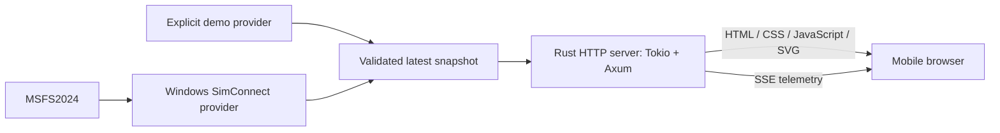
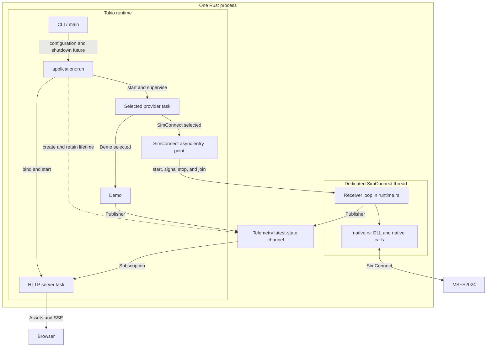

# Architecture

End-to-end data flow, component responsibilities, application lifecycle, and library boundaries.

> This document defines architecture. [GitHub Issues](https://github.com/LeszekKantorek/msfs2024-artificial-horizon/issues/9) track implementation and acceptance.

## System overview



The diagram shows two source paths feeding the same browser display:

* The SimConnect provider receives flight data from MSFS2024.
* Demo generates synthetic samples.
* The selected provider publishes normalized telemetry into one validated latest snapshot.
* The Rust HTTP server delivers that state through SSE. It also serves the browser assets.
* The mobile browser validates incoming telemetry and renders the flight instruments.

## Components and execution

### Component responsibilities

| Component | Owns |
| --- | --- |
| CLI | clap parsing, help/version, typed configuration, process signals and exit status |
| Application | Source selection, channel ownership, HTTP preparation, producer startup and coordinated shutdown |
| Configuration | HTTP listen address and port validation |
| Telemetry | Normalized attitude, validity, sequence, freshness |
| Demo provider | Repeatable synthetic scenarios with explicit telemetry source identity |
| SimConnect provider | SDK types, dispatch, units/signs, simulator lifecycle |
| State distribution | One latest snapshot, bounded memory, shared clients |
| HTTP | Static assets, health, SSE framing, subscriptions, graceful shutdown |
| Browser | Message validation, instrument/status display, receive timeout |

### Application composition

The application follows these composition constraints:

* Select exactly one provider at startup.
* Keep acquisition, normalization, current state, and HTTP in one Rust process.
* Application composition connects either Demo or the SimConnect receiver to the same HTTP/SSE server.
* The server receives a prepared subscription and does not select or start providers.

> A provider failure must never select Demo automatically.

| Interface | Contract |
| --- | --- |
| CLI | Parse source, HTTP address/port, optional SimConnect DLL/log, help, and version. Own process signals and exit status |
| `Config` | Contain only `listen_address` and `port`. Never read process arguments |
| `application::SourceSelection` | Select `Demo` or `SimConnect(SimConnectConfig)` explicitly |
| `application::run(config, source, shutdown)` | Validate configuration, create the channel, bind HTTP, start components, and collect results. Return `Result<(), ApplicationError>` |
| Application shutdown future | Caller-owned future with output `io::Result<()>`. Only the CLI handles process signals |
| `Source` | Identify the channel source for its lifetime, independently of HTTP configuration |
| `Server` | Accept a prepared subscription and caller-owned shutdown without selecting or starting acquisition |

### Async tasks and native worker

The execution model separates application coordination, asynchronous tasks, and native acquisition:



The diagram shows execution and ownership within one process:

* The application starts exactly one provider path.
* HTTP and provider tasks run concurrently in the Tokio runtime.
* A dedicated thread owns native SimConnect calls and message processing.
* The provider publishes through `Publisher`; HTTP reads through `Subscription`.
* Application composition coordinates shutdown and collects both component results.
* Acquisition failure alone does not stop HTTP.

| Element | Responsibility |
| --- | --- |
| Tokio runtime | Execute asynchronous application tasks. The CLI entry point uses `#[tokio::main]` |
| `application` | Create the telemetry channel, prepare HTTP, start the selected provider, and coordinate completion |
| SimConnect `runtime.rs` | Start and stop the native worker, run reception and publication, and wait for worker completion |
| SimConnect `native.rs` | Load the DLL, expose native calls, and decode received messages |
| `Server` in `http` | Deliver HTTP/SSE through the supplied subscription |

The provider's `runtime.rs` is distinct from the Tokio runtime. It contains both the asynchronous entry point and code executed on the dedicated thread.

### Browser boundary

The browser receives telemetry from either provider through the same HTTP/SSE contract:

* Validate incoming snapshots and normalize optional indications independently.
* Present received values without generating independent flight data or sending setting/control commands.
* Keep connection recovery and presentation scheduling in the browser.
* Invalidate unavailable or expired data instead of displaying retained readings as live.
* Apply no interpolation or extrapolation.

Delivery preserves these system constraints:

* Retain one Rust process, SSE, plain JavaScript, and SVG.
* Use a relative, same-origin SSE URL and embed web assets in the binary.
* Require no CDN, frontend package manager, CORS policy, or database.

The [EFI guide](efi/index.md) defines extension scope and routes presentation work to the relevant component contracts.

## Telemetry flow and contracts

```text
Rust process: Provider -> Publisher -> latest state -> Subscription -> Snapshot -> SSE
Browser:      SSE -> validate -> latest sample -> animation frame -> SVG/DOM
```

The flow separates acquisition, shared state, delivery, and presentation. The Rust-process path includes the provider and publication, which the HTTP server does not own.

### Acquisition and publication

| Transition | Behavior | Boundary |
| --- | --- | --- |
| Provider -> Publisher | Publish normalized live data or an explicit unavailable state | SDK types remain inside the provider |
| Publisher -> latest state | Retain the current state and notify subscribers of changes | No history queue |

### Latest-state distribution

| Rule | Mechanism |
| --- | --- |
| Retain current state only | Tokio latest-value watch channel, no history queue |
| Isolate slow consumers | Skip intermediate samples and bound per-client buffering |
| Keep age current | Recompute age before serialization |
| Detect silent sources | Expire samples server-side even without publications |
| Release stalled clients | Close writers that exceed the socket deadline |

A subscription reads the shared current state. Snapshot reads calculate freshness at access time; slow consumers can skip intermediate samples without delaying acquisition.

### HTTP/SSE delivery and browser consumption

| Transition | Behavior | Boundary |
| --- | --- | --- |
| Subscription -> Snapshot | Read current state and calculate its age | Each client reads independently; intermediate samples may be skipped |
| Snapshot -> SSE | Serialize the snapshot and send an event | Delivery does not control acquisition |
| SSE -> validation | Validate the message and normalize optional indications independently | The browser does not generate independent flight data |
| Latest sample -> animation frame | Accept fresh samples and coalesce draws | Sample acceptance and drawing have separate roles |
| Animation frame -> SVG/DOM | Update instruments while checking data validity | No interpolation or extrapolation |

Delivery and presentation have separate owners:

| Owner | Responsibility | Reference |
| --- | --- | --- |
| HTTP server | Delivery and connection closure, independently of acquisition. Preserve source-failure isolation | [SSE delivery and shutdown](server.md#sse-delivery) |
| Browser | Connection recovery and presentation scheduling | [Browser boundary](#browser-boundary) |

### Library telemetry interface

| API / owner | Behavior |
| --- | --- |
| `telemetry::channel(Source)` | Return one `Publisher` and a cloneable `Subscription`. Fix source identity for the channel lifetime |
| `Publisher` | Accept typed `State`. Only `State::Live(Attitude)` carries validated normalized degrees |
| Provider | Emit live only for fresh callbacks from an active, unpaused source. Otherwise emit explicit unavailable states |
| `Publisher::expire()` | Call on an independent 50 ms freshness tick, even without callbacks |
| `Subscription::snapshot()` | Read current state without acknowledging pending publication |
| `changed().await` | Wait for and acknowledge the newest publication |
| `snapshot_and_update()` | Read and acknowledge atomically for the first SSE event, preventing duplicate delivery of a pending publication |
| Snapshot reads | Compute age immediately and suppress expired live attitude, even before the freshness tick |
| `Snapshot` | Immutable serializable v1 value. Acquire immediately before sending. Never serialize the internal accepted-sample timestamp |

## Application lifecycle

[ADR 0007](adr/0007-application-composition.md) defines composition and supersedes the original producer ownership in ADR 0002.

### Startup

1. Validate configuration and the syntax of any selected SimConnect DLL path.
2. Create the `waiting` telemetry channel and retain its lifetime handle.
3. Bind HTTP with the prepared subscription. A failed bind prevents acquisition from starting.
4. Start the HTTP task and the selected provider task.

* HTTP availability does not depend on DLL loading, simulator connection, or flight readiness.

### Source failure and service availability

* Retain a nonpublishing handle to the same watch channel while the selected provider owns the only active `Publisher`.
* After the provider releases publication, recover the latest state and publish `disconnected` without renewing the last sample time.
* Keep existing SSE streams and the latest unavailable state accessible until HTTP ends. Never restart a permanently failed provider or select Demo automatically.
* Keep source health separate from HTTP liveness. `/health` can succeed while telemetry reports an unavailable simulator.

### Browser connection lifecycle

1. The browser requests assets through HTTP GET.
2. One EventSource GET opens the subscription.
3. The server sends current state immediately.
4. The browser receives telemetry until the subscription closes.
5. A reconnect receives current state without replay.

* Application telemetry flows toward the browser only. HTTP requests and transport acknowledgements still exist.
* EventSource supports reconnects. The page controls retries as defined in [ADR 0002](adr/0002-sse-connection-lifecycle.md).
* After background/resume, display waiting until a new valid snapshot arrives.
* Do not extrapolate attitude through pauses or disconnections.

### Coordinated shutdown

* Ctrl+C or HTTP failure signals a shared shutdown. Collect HTTP and provider results independently.
* Wait for the native worker. Do not abort it. A permanently blocked native call has no guaranteed completion deadline.
* The server owns only HTTP shutdown and connection closure. Repeated shutdown signals preserve the first connection deadline.
* An application infrastructure failure also initiates coordinated shutdown. Signal both components before waiting for their results.

## Library and platform constraints

The `msfs2024_artificial_horizon` library exposes these boundaries:

| Library boundary | Contract |
| --- | --- |
| Application assembly | Separate from reusable providers, telemetry, and HTTP |
| Crate root | Re-exports `Config`, `ConfigError`, `Source`, `Server`, and `ServerError` |
| Providers | Public interfaces through `providers::demo` and `providers::simconnect` |

Package organization follows these constraints:

* Put reusable logic in one library package and thin executables in `src/bin/`.
* Add packages or services only for a concrete need.

Platform and native integration follow these constraints:

* Keep SDK types outside telemetry and HTTP.
* Give a dedicated worker ownership of native SimConnect calls and message processing.
* Send normalized state from that worker to the async runtime.
* Support Rust builds and runtime on Windows x64 MSVC only. Run application builds and test suites locally. Retain the GitHub PR acceptance control.
* Reject other targets at the library root.
* Provider modules do not need separate platform gates.
* Expose no Cargo features from this package.
* Select the source through runtime configuration.
* Keep SimConnect integration inside the Windows provider module.
* Keep Windows tests and demo builds independent of the SDK.

[ADR 0006](adr/0006-simconnect-manual-ffi.md) defines native binding, loading, and publication decisions.

Executable configuration follows these rules:

* The executable is named `msfs2024-artificial-horizon`.
* Its thin entry point is `src/bin/main.rs`.
* Future executables use their own binary names.

| Task | Procedure |
| --- | --- |
| Run the application | [README startup procedure](../README.md#start-the-demo) |
| Prepare development tools | [Development environment](../CONTRIBUTING.md#environment-setup) |

## Deployment

| Setting | Rule |
| --- | --- |
| Intended default | `127.0.0.1:8080` |
| Explicit LAN mode | Bind a selected interface or `0.0.0.0:8080` |
| Startup URL | Display an actual LAN IP for the phone |
| Network | Use the same private network and a firewall rule scoped to it |
| Access | LAN devices can read telemetry without authentication |
| Remote access | Requires a separate access-control/TLS decision |

> `localhost` on a phone refers to the phone. Port forwarding and public hosting are outside MVP scope.

## Component references

The component references provide detailed interfaces:

| Responsibility | Reference |
| --- | --- |
| HTTP configuration, binding, routers, assets, and connection shutdown | [Server](server.md) |
| Acquisition and normalization | [Source providers](sources/index.md) |
| Deterministic scenarios and timing | [Demo](sources/demo.md) |
| Native acquisition, diagnostics, and evidence limits | [SimConnect](sources/simconnect.md) |
| Fields, units, validation, freshness, and compatibility | [Telemetry contract](telemetry-contract.md) |
| Presentation and browser module responsibilities | [EFI guide](efi/index.md) and [composition](efi/composition.md) |
