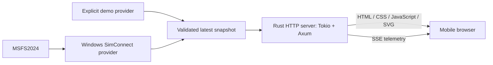

# Architecture

Target design, component responsibilities, and runtime boundaries.

> This document defines architecture. [GitHub Issues](roadmap.md) track implementation and acceptance.

## System



* Select exactly one provider at startup.
* Keep acquisition, normalization, current state, and HTTP in one Rust process.
* Put reusable logic in one library package and thin executables in `src/bin/`.
* Add packages or services only for a concrete need.

Application composition connects either Demo or the SimConnect receiver to the same HTTP/SSE server.
The server receives a prepared subscription and does not select or start providers.

> A provider failure must never select demo automatically.

## Boundaries

| Component | Owns |
| --- | --- |
| CLI | clap parsing, help/version, typed configuration, process signals and exit status |
| Application | Source selection, channel ownership, HTTP preparation, producer startup and coordinated shutdown |
| Configuration | HTTP listen address and port validation |
| Telemetry | Normalized attitude, validity, sequence, freshness |
| Demo provider | Repeatable synthetic scenarios with explicit telemetry source identity |
| SimConnect provider | SDK types, dispatch, units/signs, simulator lifecycle |
| State distribution | One latest snapshot, bounded memory, shared clients |
| HTTP | Static assets, health, SSE framing, subscriptions, graceful shutdown |
| Browser | Message validation, instrument/status display, receive timeout |

* Keep SDK types outside telemetry and HTTP.
* Give a dedicated worker ownership of native SimConnect calls and message processing.
* Send normalized state from that worker to the async runtime.
* Support Rust builds and runtime on Windows x64 MSVC only. Run application builds and test suites locally; retain the GitHub PR acceptance control.
* Reject other targets at the library root.
* Provider modules do not need separate platform gates.
* Expose no Cargo features from this package.
* Select the source through runtime configuration.
* Keep SimConnect integration inside the Windows provider module.
* Keep Windows tests and demo builds independent of the SDK.

### State distribution

| Rule | Mechanism |
| --- | --- |
| Retain current state only | Tokio latest-value watch channel, no history queue |
| Isolate slow consumers | Skip intermediate samples and bound per-client buffering |
| Keep age current | Recompute age before serialization |
| Detect silent sources | Expire samples server-side even without publications |
| Release stalled clients | Close writers that exceed the socket deadline |

## Intended source layout

Environment setup: [CONTRIBUTING](../CONTRIBUTING.md#environment-setup).

The repository groups the application by responsibility:

| Path | Responsibility |
| --- | --- |
| `src/bin/` | CLI entry point |
| `src/application.rs` | Source selection, channel lifetime, startup, and shutdown |
| `src/providers/` | Demo and SimConnect acquisition |
| `src/telemetry.rs` | Validated model, latest state, and subscriptions |
| `src/http/` | Embedded assets, health, and SSE delivery |
| `web/` | Browser telemetry and instrument presentation |
| `tests/` | Integration tests and fixtures |

The [backend implementation guide](backend-implementation.md) explains the data flow and component collaboration.
The [telemetry sources guide](sources/index.md) describes Demo and SimConnect.
The [panel presentation](efi/index.md) describes the browser module boundaries.
The source tree is authoritative for individual files.

### Application API

The library exposes `Config`, `Source`, and `Server`. Application composition selects a source, creates the telemetry channel, and coordinates startup and shutdown.

* `Config` contains only the HTTP listen address and port. Library configuration does not read process arguments.
* `Source` identifies the channel source; source selection belongs to application composition.
* `Server::bind` receives an existing subscription and validates HTTP configuration before binding. The server does not select or start a provider.
* The server accepts caller-owned shutdown; only the CLI handles process signals. The static router is independent of telemetry.
* Providers receive a publisher and shutdown signal. They do not depend on application configuration or create a hidden channel or queue.
* The SimConnect entry point reports acquisition outcome separately from diagnostic status.
* SimConnect configuration permits an absolute DLL override and an exact log file. The resolver uses the same executable-relative default for CLI and library calls before opening a log or loading native code.
* HTTP availability does not depend on DLL loading, simulator connection, or flight readiness.

The [backend API reference](backend-implementation.md#public-application-interfaces) describes the public entry points. [ADR 0007](adr/0007-application-composition.md) defines the composition and public server boundary. The [SimConnect guide](sources/simconnect.md) describes source configuration and diagnostics. Run the application using the [README procedure](../README.md#start-the-demo).

Web assets are embedded in the release binary. The client uses a relative, same-origin SSE URL and requires no CDN, frontend package manager, CORS policy, or database.

## Session and lifecycle

1. The browser requests assets through HTTP GET.
2. One EventSource GET opens the subscription.
3. The server sends current state immediately.
4. The browser receives telemetry until the subscription closes.
5. A reconnect receives current state without replay.

* Application telemetry flows toward the browser only. HTTP requests and transport acknowledgements still exist.
* EventSource supports reconnects. The page controls retries as defined in [ADR 0002](adr/0002-sse-connection-lifecycle.md).
* Keep source health separate from HTTP liveness. `/health` can succeed while telemetry reports an unavailable simulator.
* After background/resume, display waiting until a new valid snapshot arrives.
* Do not extrapolate attitude through pauses or disconnections.

## Deployment

| Setting | Rule |
| --- | --- |
| Intended default | `127.0.0.1:8080` |
| Explicit LAN mode | Bind a selected interface or `0.0.0.0:8080` |
| Startup URL | Display an actual LAN IP for the phone |
| Network | Use the same private network and a firewall rule scoped to it |
| Access | LAN devices can read telemetry without authentication |
| Remote access | Requires a separate access-control/TLS decision |

> `localhost` on a phone refers to the phone. Port forwarding and public hosting are outside MVP scope.

## SimConnect integration

The SimConnect provider uses minimal manual bindings and runtime DLL loading within the existing Rust package.
One native worker owns acquisition and publishes normalized telemetry through the caller-owned channel.
[ADR 0006](adr/0006-simconnect-manual-ffi.md) defines the binding, loading, and publication decisions.
The demo does not load SimConnect, and a SimConnect failure never selects the demo.
Windows builds do not require SDK headers or binaries.

The [SimConnect mode](sources/simconnect.md) publishes attitude through the same HTTP/SSE and browser contract as Demo.
[ADR 0007](adr/0007-application-composition.md) defines composition, source-failure isolation and shutdown.
The [SimConnect guide](sources/simconnect.md#live-publication-evidence) describes the tested scope and evidence limits.
[Issue #8](https://github.com/LeszekKantorek/msfs2024-artificial-horizon/issues/8) covers packaging and DLL distribution conditions.
Runtime loading does not establish redistribution permission.

## EFI demo extension

[ADR 0003](adr/0003-responsive-pfd-demo.md) defines the demo extension. The [project brief](project-brief.md) defines its scope.

* Rust owns deterministic Demo scenarios and selected values shared by subscribers. Demo data retains its source identity.
* The browser presents received values without inventing flight data or issuing setting or control commands.
* Optional normalized v1 indications preserve attitude meanings, lifecycle states, and attitude-only publication. Each indication has independent availability.
* Missing or invalid values must not become zero, retained values, or Demo data. Older snapshots without extensions remain supported.
* Feature requirements and fixtures belong to the relevant feature. Do not advertise unimplemented fields as current contract fields.

### Attitude and coordinated-turn boundary

Providers publish validated, normalized samples through the shared channel. The browser validates the envelope and optional indications before presentation. The [telemetry contract](telemetry-contract.md) defines fields, units, validity, freshness, and compatibility. The [EFI feature guide](efi/index.md) owns instrument requirements and presentation details.

### Panel boundary

Browser assembly connects telemetry, lifecycle, layout, and presentation. The telemetry client owns connection, validation, retries, and freshness. The frame scheduler coalesces draws and retains expiry deadlines; the panel composes instruments and obscures unavailable data.

The [panel presentation](efi/index.md) defines shared responsibilities and feature ownership. [Frame lifecycle](efi/lifecycle.md#panel-interface-and-frame-lifecycle), [composition](efi/composition.md), and [telemetry operations](efi/telemetry.md#telemetry-operations) define the detailed contracts. [ADR 0004](adr/0004-modular-pfd-presentation.md) and [ADR 0005](adr/0005-visual-object-composition.md) record the design rationale.

Embedded asset delivery preserves paths, MIME types, status codes, response bodies, and GET/HEAD behavior. Static routes remain independent of telemetry. Replaced root and calculation-module routes return 404 without compatibility facades. Do not add wildcard routes, directory serving, runtime file access, or dependencies.

## Library telemetry interface

```text
Server:  Provider -> Publisher -> latest state -> Subscription -> Snapshot -> SSE
Browser: SSE -> validate -> latest sample -> animation frame -> SVG/DOM
```

The channel fixes source identity for its lifetime and distributes the latest value without a history queue. A provider publishes live only for fresh samples from an active, unpaused source; otherwise it publishes an explicit unavailable state. An independent 50 ms freshness tick expires samples even without callbacks. Snapshot reads calculate age and suppress expired live attitude, including between ticks. Internal sample timestamps are not serialized.

The subscription operations have distinct acknowledgment semantics:

| Operation | Contract |
| --- | --- |
| `snapshot()` | Read the current state without acknowledging a pending change |
| `snapshot_and_update()` | Read and acknowledge the current publication atomically |
| `changed().await` | Wait for and acknowledge the newest publication, skipping intermediate values |

The first SSE event uses `snapshot_and_update()` to avoid duplicate delivery. The [telemetry contract](telemetry-contract.md#freshness-and-status) defines freshness and wire behavior. The [SSE decision](adr/0002-sse-connection-lifecycle.md) defines delivery and connection limits.

### Server and browser ownership

Application composition validates configuration and binds HTTP before starting acquisition. It retains the channel while the provider owns the active publisher. After provider failure, existing and new clients can receive the latest unavailable state; a permanently failed provider is not restarted and Demo is not selected automatically.

A shared shutdown coordinates HTTP and acquisition and collects their results independently. The native worker is awaited, not aborted; a permanently blocked native call has no guaranteed completion deadline. [ADR 0007](adr/0007-application-composition.md) defines startup, failure, and shutdown details. HTTP enforces the [socket deadlines](adr/0002-sse-connection-lifecycle.md#socket-deadlines).

The browser owns connection recovery and scheduling. It retains the latest sample and checks its original expiry deadline before drawing. It cancels invalid work and does not interpolate or extrapolate current readings. The [frame lifecycle](efi/lifecycle.md#panel-interface-and-frame-lifecycle) and [browser telemetry contract](efi/telemetry.md) define the detailed behavior.
