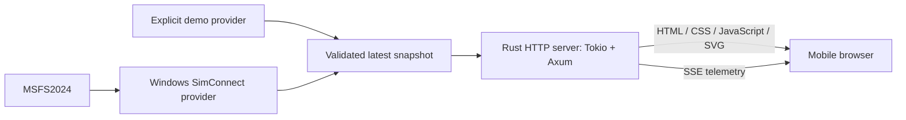

# Architecture

End-to-end data flow, component responsibilities, application lifecycle, and library boundaries.

> This document defines architecture. [GitHub Issues](roadmap.md) track implementation and acceptance.

## System



The SimConnect provider receives flight data from MSFS2024, while Demo generates synthetic samples.
The selected provider publishes normalized telemetry into one validated latest snapshot.
The Rust HTTP server delivers that state to the mobile browser through SSE and serves the browser assets.
The browser validates incoming telemetry and renders the flight instruments.

## Boundaries

| Component | Owns |
| --- | --- |
| CLI | clap parsing, help/version, typed configuration, process signals and exit status |
| Application | Source selection, channel ownership, HTTP preparation, producer startup and coordinated shutdown |
| Configuration | HTTP listen address and port validation |
| Telemetry | Normalized attitude, validity, sequence, freshness |
| Demo provider | Repeatable synthetic scenarios with explicit telemetry source identity |
| SimConnect provider | SDK types, dispatch, units/signs, simulator lifecycle |
| State distribution | One latest snapshot, bounded memory, shared clients |
| HTTP | Static assets, health, SSE framing, subscriptions, graceful shutdown |
| Browser | Message validation, instrument/status display, receive timeout |

### Process and source ownership

The application follows these composition constraints:

* Select exactly one provider at startup.
* Keep acquisition, normalization, current state, and HTTP in one Rust process.
* Put reusable logic in one library package and thin executables in `src/bin/`.
* Add packages or services only for a concrete need.

Application composition connects either Demo or the existing SimConnect receiver to the same HTTP/SSE server.
The server receives a prepared subscription and does not select or start providers.

> A provider failure must never select Demo automatically.

### Platform and native integration

* Keep SDK types outside telemetry and HTTP.
* Give a dedicated worker ownership of native SimConnect calls and message processing.
* Send normalized state from that worker to the async runtime.
* Support Rust builds and runtime on Windows x64 MSVC only. Run application builds and test suites locally. Retain the GitHub PR acceptance control.
* Reject other targets at the library root.
* Provider modules do not need separate platform gates.
* Expose no Cargo features from this package.
* Select the source through runtime configuration.
* Keep SimConnect integration inside the Windows provider module.
* Keep Windows tests and demo builds independent of the SDK.

### State distribution

| Rule | Mechanism |
| --- | --- |
| Retain current state only | Tokio latest-value watch channel, no history queue |
| Isolate slow consumers | Skip intermediate samples and bound per-client buffering |
| Keep age current | Recompute age before serialization |
| Detect silent sources | Expire samples server-side even without publications |
| Release stalled clients | Close writers that exceed the socket deadline |

## Application API

The `msfs2024_artificial_horizon` library separates application assembly from reusable providers, telemetry, and HTTP.
The crate root re-exports `Config`, `ConfigError`, `Source`, `Server`, and `ServerError`.
Provider-specific interfaces remain public through `providers::demo` and `providers::simconnect`.

| Interface | Contract |
| --- | --- |
| CLI | Parse source, HTTP address/port, optional SimConnect DLL/log, help, and version. Own process signals and exit status |
| `Config` | Contain only `listen_address` and `port`. Never read process arguments |
| `application::SourceSelection` | Select `Demo` or `SimConnect(SimConnectConfig)` explicitly |
| `application::run(config, source, shutdown)` | Validate configuration, create the channel, bind HTTP, start components, and collect results. Return `Result<(), ApplicationError>` |
| Application shutdown future | Caller-owned future with output `io::Result<()>`. Only the CLI handles process signals |
| `Source` | Identify the channel source for its lifetime, independently of HTTP configuration |
| `Server` | Accept a prepared subscription and caller-owned shutdown without selecting or starting acquisition |

The executable is named `msfs2024-artificial-horizon`, with its thin entry point in `src/bin/main.rs`.
Future executables use their own binary names.
Use the [README startup procedure](../README.md#start-the-demo) or the [development environment](../CONTRIBUTING.md#environment-setup).

The component references provide detailed interfaces:

| Responsibility | Reference |
| --- | --- |
| HTTP configuration, binding, routers, assets, and connection shutdown | [Server](server.md) |
| Acquisition and normalization | [Source providers](sources/index.md) |
| Deterministic scenarios and timing | [Demo](sources/demo.md) |
| Native acquisition, diagnostics, and evidence limits | [SimConnect](sources/simconnect.md) |
| Fields, units, validation, freshness, and compatibility | [Telemetry contract](telemetry-contract.md) |
| Presentation and browser module responsibilities | [EFI guide](efi/index.md) and [composition](efi/composition.md) |

## Library telemetry interface

```text
Server:  Provider -> Publisher -> latest state -> Subscription -> Snapshot -> SSE
Browser: SSE -> validate -> latest sample -> animation frame -> SVG/DOM
```

| API / owner | Behavior |
| --- | --- |
| `telemetry::channel(Source)` | Return one `Publisher` and a cloneable `Subscription`. Fix source identity for the channel lifetime |
| `Publisher` | Accept typed `State`. Only `State::Live(Attitude)` carries validated normalized degrees |
| Provider | Emit live only for fresh callbacks from an active, unpaused source. Otherwise emit explicit unavailable states |
| `Publisher::expire()` | Call on an independent 50 ms freshness tick, even without callbacks |
| `Subscription::snapshot()` | Read current state without acknowledging pending publication |
| `changed().await` | Wait for and acknowledge the newest publication |
| `snapshot_and_update()` | Read and acknowledge atomically for the first SSE event, preventing duplicate delivery of a pending publication |
| Snapshot reads | Compute age immediately and suppress expired live attitude, even before the freshness tick |
| `Snapshot` | Immutable serializable v1 value. Acquire immediately before sending. Never serialize the internal accepted-sample timestamp |

## Session and lifecycle

1. The browser requests assets through HTTP GET.
2. One EventSource GET opens the subscription.
3. The server sends current state immediately.
4. The browser receives telemetry until the subscription closes.
5. A reconnect receives current state without replay.

* Application telemetry flows toward the browser only. HTTP requests and transport acknowledgements still exist.
* EventSource supports reconnects. The page controls retries as defined in [ADR 0002](adr/0002-sse-connection-lifecycle.md).
* Keep source health separate from HTTP liveness. `/health` can succeed while telemetry reports an unavailable simulator.
* After background/resume, display waiting until a new valid snapshot arrives.
* Do not extrapolate attitude through pauses or disconnections.

### Server and browser ownership

HTTP availability does not depend on DLL loading, simulator connection, or flight readiness.
Application composition owns acquisition and its shutdown lifecycle:

* Validate configuration and create the `waiting` channel before binding HTTP. Start the provider only after a successful bind.
* Retain a nonpublishing handle to the same watch channel while the selected provider owns the only active `Publisher`.
* After the provider releases publication, recover the latest state and publish `disconnected` without renewing the last sample time.
* Keep existing SSE streams and the latest unavailable state accessible until HTTP ends. Never restart a permanently failed provider or select Demo automatically.
* Ctrl+C or HTTP failure signals a shared shutdown. Collect HTTP and provider results independently.
* Wait for the native worker. Do not abort it. A permanently blocked native call has no guaranteed completion deadline.
* The server owns only HTTP shutdown and connection closure. Repeated shutdown signals preserve the first connection deadline.

HTTP owns delivery and connection closure, independently of acquisition.
Its [SSE delivery and shutdown](server.md#sse-delivery) operate below the producer and preserve source-failure isolation.
The browser owns connection recovery and presentation scheduling through the [panel boundary](#panel-boundary).
[ADR 0007](adr/0007-application-composition.md) defines composition and supersedes the original producer ownership in ADR 0002.

## Deployment

| Setting | Rule |
| --- | --- |
| Intended default | `127.0.0.1:8080` |
| Explicit LAN mode | Bind a selected interface or `0.0.0.0:8080` |
| Startup URL | Display an actual LAN IP for the phone |
| Network | Use the same private network and a firewall rule scoped to it |
| Access | LAN devices can read telemetry without authentication |
| Remote access | Requires a separate access-control/TLS decision |

> `localhost` on a phone refers to the phone. Port forwarding and public hosting are outside MVP scope.

## SimConnect integration

The SimConnect provider uses minimal manual bindings and runtime DLL loading within the existing Rust package.
One native worker owns acquisition and publishes normalized telemetry through the caller-owned channel.
[ADR 0006](adr/0006-simconnect-manual-ffi.md) defines the binding, loading, and publication decisions.
The demo does not load SimConnect, and a SimConnect failure never selects the demo.
Windows builds do not require SDK headers or binaries.

The [SimConnect mode](sources/simconnect.md) publishes attitude and available optional instrument data through the same HTTP/SSE and browser contract as Demo.
[ADR 0007](adr/0007-application-composition.md) defines composition, source-failure isolation and shutdown.
The [SimConnect guide](sources/simconnect.md#live-publication-evidence) describes the tested scope and evidence limits.
[Issue #8](https://github.com/LeszekKantorek/msfs2024-artificial-horizon/issues/8) covers packaging and DLL distribution conditions.
Runtime loading does not establish redistribution permission.

## EFI extension boundary

The [project brief](project-brief.md) defines scope, and [ADR 0003](adr/0003-responsive-pfd-demo.md) records the original Demo extension decision.
The current SimConnect provider also supplies available optional instruments through the same normalized contract.

* Retain one Rust process, SSE, plain JavaScript, and SVG.
* Keep deterministic Demo scenarios and selected values in Rust, shared by all subscribers.
* Let the browser present received values without independent flight data or setting/control commands.
* Add optional normalized v1 fields without changing attitude meanings, lifecycle states, or pitch/bank-only publication.
* Keep missing extensions unavailable in old snapshots and attitude-only publications.
* Define field names, validity, and fixtures in the feature that introduces them.
* Do not advertise unimplemented fields as current contract fields.
* Demo extensions add no SDK requirements. Performance #7 and packaging #8 remain separate work.

## Panel boundary

[Panel presentation](efi/index.md) defines the module tree, frame lifecycle, and layer composition.

[ADR 0004](adr/0004-modular-pfd-presentation.md) defines instrument composition and layers. [ADR 0005](adr/0005-visual-object-composition.md) defines visual-object composition and calculation ownership.

| Module | Responsibility |
| --- | --- |
| Application assembly | Connect telemetry, layout, lifecycle, and presentation |
| Telemetry client | Own EventSource, sequence, retries, expiry, status, and lifecycle |
| Telemetry validation | Pure envelope validation and independent optional-value normalization |
| Frame scheduler | Coalesce latest samples, retain deadlines, cancel invalid work |
| Panel and instruments | Compose visual objects under the presentation contracts linked below |
| Status presentation | Show source/transport status and obscure invalid data |

The presentation reference owns these contracts:

* [Panel interface and frame lifecycle](efi/lifecycle.md#panel-interface-and-frame-lifecycle): normalized read-only frames, initialization, scheduling, and invalidation.
* [Internal seams](efi/composition.md#internal-module-seams): visual ownership, private nodes, shared hosts/clips, and concrete child inputs.
* [Pure calculations and helpers](efi/composition.md#pure-calculations-and-helpers): calculation ownership, actual shared consumers, and DOM-free imports.
* [Telemetry operations](efi/telemetry.md#telemetry-operations): validation, callback publication, and connection lifecycle.
* [Delivery boundaries](efi/composition.md#delivery-boundaries): future instruments and asset integration.

The browser retains one latest sample and at most one pending animation frame.
It accepts each fresh sample before coalescing draws, preserving instrument history such as selected-altitude alerts.
Resize retains the original sample deadline. Rendering checks expiry and cancels invalid work.
No interpolation or extrapolation is applied.

* Use a relative, same-origin SSE URL and embed web assets in the binary.
* Require no CDN, frontend package manager, CORS policy, or database.
* Keep detailed browser module responsibilities in [composition](efi/composition.md).
* Keep timed alerts, resize, and invalidation in the [frame lifecycle](efi/lifecycle.md).
* Keep attitude transforms and screen-space clipping in [rendering](efi/rendering.md).
