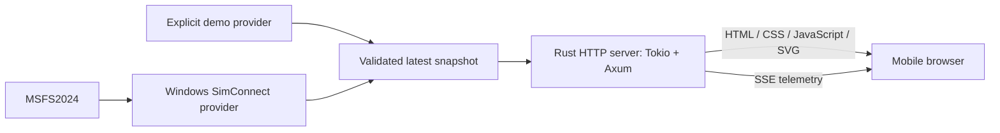

# Architecture

Target design, component responsibilities, and runtime boundaries.

> This document defines architecture. [GitHub Issues](roadmap.md) track implementation and acceptance.

## System



* Select exactly one provider at startup.
* Keep acquisition, normalization, current state, and HTTP in one Rust process.
* Put reusable logic in one library package and thin executables in `src/bin/`.
* Add packages or services only for a concrete need.

> A provider failure must never select demo automatically.

## Boundaries

| Component | Owns |
| --- | --- |
| CLI | clap parsing, help/version, conversion to typed configuration, process signals |
| Configuration | Source selection, listen address/port validation, sampling settings |
| Telemetry | Normalized attitude, validity, sequence, freshness |
| Demo provider | Repeatable synthetic scenarios with explicit telemetry source identity |
| SimConnect provider | SDK types, callbacks, units/signs, simulator lifecycle |
| State distribution | One latest snapshot, bounded memory, shared clients |
| HTTP | Static assets, health, SSE framing, subscriptions, graceful shutdown |
| Browser | Message validation, instrument/status display, receive timeout |

* Keep SDK types outside telemetry and HTTP.
* Give a dedicated worker ownership of blocking SimConnect callbacks.
* Send normalized state from that worker to the async runtime.
* Support Rust builds, runtime, and CI on Windows x64 MSVC only.
* Reject other targets at the library root.
* Provider modules do not need separate platform gates.
* Expose no Cargo features from this package.
* Select the source through runtime configuration.
* Keep SimConnect integration inside the Windows provider module.
* Keep Windows tests and demo builds independent of the SDK.

### State distribution

| Rule | Mechanism |
| --- | --- |
| Retain current state only | Tokio latest-value watch channel, no history queue |
| Isolate slow consumers | Skip intermediate samples and bound per-client buffering |
| Keep age current | Recompute age before serialization |
| Detect silent sources | Expire samples server-side even without publications |
| Release stalled clients | Close writers that exceed the socket deadline |

## Intended source layout

Environment setup: [CONTRIBUTING](../CONTRIBUTING.md#environment-setup).

```text
Cargo.toml                  # library and binary targets, edition 2024
Cargo.lock                  # committed dependency lock
src/
  lib.rs                    # reusable API and application assembly
  bin/
    main.rs                 # clap CLI, startup, shutdown wiring
  config.rs
  telemetry.rs              # validated attitude and optional coordinated-turn values
  providers/
    mod.rs                  # source boundary
    demo.rs
    simconnect.rs           # Windows SDK integration
  http/
    mod.rs                  # asset/health composition, telemetry routes, application state
    assets.rs               # explicit compile-time asset table and registration loop
    sse.rs
web/
  index.html
  styles.css
  app.js                    # telemetry, panel, resize, and page lifecycle assembly
  telemetry/
    client.js               # EventSource, status, freshness, retries, and lifecycle
    validation.js           # pure snapshot validation and optional-value normalization
  frame-scheduler.js        # latest-frame scheduling and expiry checks
  panel.js                  # composition, shared attitude clip, and delegation
  heading.js                # magnetic-heading scale, current pointer and selected bug
  horizon/
    index.js                # composition, shared origins/clips, pure attitude transforms
    world.js                # sky, ground, and horizon line
    pitch-scale.js          # pitch ticks, labels, and extreme-pitch chevrons
    bank-pointer.js         # moving bank pointer
  fixed-symbols/
    index.js                # fixed-symbol composition and common origin
    bank-scale.js           # fixed bank scale
    aircraft.js             # aircraft reference and outline
  slip-skid.js              # local slip/skid presentation
  turn-rate.js              # local turn-rate presentation
  airspeed/
    index.js                # IAS/TAS/GS composition and shared GS vertical position
    ias.js                  # IAS readings/geometry, composition, shared tape host/clip
    ground-speed.js         # independent GS readout and warning
    true-airspeed.js         # independent top-strip TAS readout and local availability
    tape.js                 # scale, ranges, and trend
    readout.js              # window, rolling digits, unit, and IAS warning
    references.js           # tape markers/leaders and fallback values
    helpers.js              # shared speed state, display limit, and tape offset
  status.js                 # accessible status and unavailability
  altitude/
    index.js                # composition, shared tape clip, state and geometry
    tape.js                 # fixed pixel spacing and a retained tick pool that grows on resize
    readout.js              # pointer window, sign, 20-ft drums and display limits
    baro.js                 # independent source-formatted BARO text and availability
    selected.js             # source target, tape bug, and alert history
    vsi.js                  # compact ft/min window, formatting, geometry and independent availability
    trend.js                # six-second altitude prediction and clipped magenta line
  helpers.js                # clamp, SVG creation, and attribute updates
  layout.js                 # responsive instrument regions in CSS pixels
tests/
  http_sse.rs
  fixtures/                 # known attitudes and lifecycle states
.github/workflows/ci.yml
```

### Application API

The `msfs2024_artificial_horizon` library exposes `Config`, `Source`, and `Server`.

| Interface | Contract |
| --- | --- |
| CLI | Use clap derive for source, address/port, help, and version |
| Library configuration | Accept typed `Config`/`Source`. Never read process arguments |
| `Server::bind` | Validate configuration before acquiring the listener |
| `Server::local_address` | Return the bound address |
| `Server::run(shutdown)` | Accept caller-owned shutdown. Only the CLI handles process signals |
| `http::router()` | Build static routes only |
| `http::router_with_telemetry(subscription)` | Add SSE with a caller-supplied channel, without starting acquisition |
| Provider types | Providers own `Source` and `SourceError` |
| Configuration errors | Wrap source availability errors in `ConfigError::Source` |
| Public types | Re-export provider types from the library |

Providers must not depend on application configuration.

Run the application with the [README procedure](../README.md#start-the-demo).
Future executables use their own binary names.
Cargo names the current executable `msfs2024-artificial-horizon`.
Its entry point remains `src/bin/main.rs`.

* Embed web assets in the release binary.
* Use a relative, same-origin SSE URL.
* The client requires no CDN, frontend package manager, CORS policy, or database.

## Session and lifecycle

1. The browser requests assets through HTTP GET.
2. One EventSource GET opens the subscription.
3. The server sends current state immediately.
4. The browser receives telemetry until the subscription closes.
5. A reconnect receives current state without replay.

* Application telemetry flows toward the browser only. HTTP requests and transport acknowledgements still exist.
* EventSource supports reconnects. The page controls retries as defined in [ADR 0002](adr/0002-sse-connection-lifecycle.md).
* Keep source health separate from HTTP liveness. `/health` can succeed while telemetry reports an unavailable simulator.
* After background/resume, display waiting until a new valid snapshot arrives.
* Do not extrapolate attitude through pauses or disconnections.

## Deployment

| Setting | Rule |
| --- | --- |
| Intended default | `127.0.0.1:8080` |
| Explicit LAN mode | Bind a selected interface or `0.0.0.0:8080` |
| Startup URL | Display an actual LAN IP for the phone |
| Network | Use the same private network and a firewall rule scoped to it |
| Access | LAN devices can read telemetry without authentication |
| Remote access | Requires a separate access-control/TLS decision |

> `localhost` on a phone refers to the phone. Port forwarding and public hosting are outside MVP scope.

## Integration uncertainty

The official [SimConnect SDK](https://docs.flightsimulator.com/msfs2024/retail/programming-apis/simconnect/simconnect-sdk/) supports add-on communication with MSFS2024.

[#5](https://github.com/LeszekKantorek/msfs2024-artificial-horizon/issues/5) must establish:

* Rust binding choice and exact SDK prerequisites.
* Simulator signs and units.
* Redistribution requirements.

Do not select a wrapper solely because it supported an earlier simulator.

See [ADR 0001](adr/0001-rust-http-sse.md) and the [wire contract](telemetry-contract.md).

## PFD demo extension

> Planned scope: [project brief](project-brief.md). Decisions: [ADR 0003](adr/0003-responsive-pfd-demo.md). Feature order: [roadmap](roadmap.md).

* Retain one Rust process, SSE, plain JavaScript, and SVG.
* Let Rust own deterministic scenarios, selected values, and the synthetic speed profile shared by all subscribers.
* Let the browser present received values without independent flight data or setting/control commands.
* Add optional normalized v1 fields without changing attitude meanings, lifecycle states, or pitch/bank-only publication.
* Keep extensions unavailable in old snapshots and the future attitude-only SimConnect provider.
* Add no SDK requirements and do not expand #5-#8.
* Define field names, validity, and fixtures in the feature that introduces them.
* Do not advertise unimplemented fields as current contract fields.

### Attitude and coordinated-turn boundary

The server owns validated samples and deterministic demo scenarios:

* `FlightSample` combines validated attitude with optional `SlipSkid` and `TurnRate` values.
* `IndicatedAirspeed` and `GroundSpeed` validate optional nonnegative knots. `FlightSample::with_speeds` adds them without changing its existing constructor.
* `AirspeedProfile` validates speed thresholds and named `VSpeedReferences`. `IasAcceleration` validates source-supplied kt/s independently.
* `FlightSample::with_airspeed_indications` adds optional configuration and acceleration. Demo configuration is fictional and shared by all clients.
* `BarometricAltitude` validates finite signed feet. BARO is producer-formatted display text stored as an optional owned string.
* `FlightSample::with_altitude` adds independently optional altitude and BARO text without changing the constructor or attitude-only path.
* `FlightSample` is cloneable rather than copyable; publishing owns its text and snapshots clone it.
* Server and browser ship together without a legacy BARO contract adapter.
* `SelectedAltitude` validates finite signed feet.
* `FlightSample::with_selected_altitude` adds the independently optional source target.
* `VerticalSpeed` validates finite signed ft/min. `FlightSample::with_vertical_speed` adds the independently optional source rate.
* `Heading` and `SelectedHeading` validate finite magnetic degrees in `[0, 360)`.
* `FlightSample::with_heading` adds both independently optional headings without changing the constructor.
* The 18-second heading demo follows source turn rate and crosses north in both directions.
* The shared altitude/target/VSI demo repeats after 198 seconds while other indications retain 18-second cycles.
* Altitude and VSI use shared analytic segments. Artificial jumps omit VSI for one sample.
* `Publisher::publish_sample` uses the existing latest-value channel, sequence, and monotonic age.
* `Publisher::publish(State)` keeps the attitude-only path and clears all optional indications.
* `demo::sample` defines nine deterministic two-second segments.
* `demo::attitude` retains its original seven-pose helper contract.
* The same 18-second sample cycle supplies acceleration, a constant-speed segment, and deceleration for independently valued IAS, TAS, and GS.

The browser validates those samples and presents them within the available panel area:

* `telemetry/validation.js` validates the snapshot and normalizes optional values independently, including copied profile references.
* `createTelemetryClient` owns the connection and publishes normalized samples with one expiry deadline.
* `airspeed/index.js` composes IAS, TAS, and GS visual objects. Each object owns its readings, geometry, and pure calculations.
* `altitude/index.js` composes its signed tape, rolling readout, independent pressure setting, and selected-altitude object in the existing right-side allocation.
* `altitude/selected.js` owns the selected readout, bug, and alert history, with DOM-free transition and phase calculations.
* `heading.js` owns the heading scale, pointer window, selected bug, pure calculations, and local availability.
* Heading occupies the existing top strip in the symbols layer and owns its clip, without reducing horizon space.
* Panel acceptance processes every fresh sample before coalescing draws.
* Timed alert updates use the same frame scheduler and its monotonic clock.
* The existing `onAttitude` callback retains its attitude-only shape.
* `pfdLayout` allocates instrument regions from available CSS width/height.
* `frame-scheduler.js` schedules fresh frames.
* `panel.js` composes instrument modules.
* Resize preserves the latest accepted sample and its original deadline.
* Sky/ground and pitch markings use separate transformed groups with separate screen-space clipping.
* Future instrument regions contain no readings or scales in the production page.
* `tests/layout-fixture.js` identifies the full 17-element arrangement built from production modules through the development fixture server.

### Panel boundary

[Panel presentation](pfd-presentation.md) defines the module tree, frame lifecycle, and layer composition.

The architecture records these distinct changes:

| Record | Boundary |
| --- | --- |
| [ADR 0004](adr/0004-modular-pfd-presentation.md), #36 and #37 | Instrument composition and layers |
| Maintenance [#54](https://github.com/LeszekKantorek/msfs2024-artificial-horizon/issues/54) | Historical separation of pure calculations and validation |
| [#56](https://github.com/LeszekKantorek/msfs2024-artificial-horizon/issues/56) and [ADR 0005](adr/0005-visual-object-composition.md) | Visual-object composition with object-specific calculations in implementing modules |

| Module | Responsibility |
| --- | --- |
| Application assembly | Connect telemetry, layout, lifecycle, and presentation |
| Telemetry client | Own EventSource, sequence, retries, expiry, status, and lifecycle |
| Telemetry validation | Pure envelope validation and independent optional-value normalization |
| Frame scheduler | Coalesce latest samples, retain deadlines, cancel invalid work |
| Panel and instruments | Compose visual objects under the presentation contracts linked below |
| Status presentation | Show source/transport status and obscure invalid data |

The presentation reference owns these contracts:

* [Panel interface and frame lifecycle](pfd-presentation.md#panel-interface-and-frame-lifecycle): normalized read-only frames, initialization, scheduling, and invalidation.
* [Internal seams](pfd-presentation.md#internal-module-seams): visual ownership, private nodes, shared hosts/clips, and concrete child inputs.
* [Pure calculations and helpers](pfd-presentation.md#pure-calculations-and-helpers): calculation ownership, actual shared consumers, and DOM-free imports.
* [Telemetry operations](pfd-presentation.md#telemetry-operations): validation, callback publication, and connection lifecycle.
* [Delivery boundaries](pfd-presentation.md#delivery-boundaries): future instruments and asset integration.

Embedded assets have a separate registration boundary:

| Module | Responsibility |
| --- | --- |
| `src/http/assets.rs` | Explicit literal path/MIME/compile-time body mappings for the current JavaScript modules, HTML, and CSS |
| `assets::router()` | Register the table through one loop |
| `src/http/mod.rs` | Compose the asset router and health route, with unchanged telemetry composition |

* Preserve existing paths, MIME types, status codes, response bodies, and GET/HEAD behavior.
* Keep static routes independent of telemetry.
* Replaced root and calculation-module routes return 404 without compatibility facades.
* Add no wildcard routes, directory serving, runtime file access, or dependencies.

## Library telemetry interface

```text
Server:  Provider -> Publisher -> latest state -> Subscription -> Snapshot -> SSE
Browser: SSE -> validate -> latest sample -> animation frame -> SVG/DOM
```

| API / owner | Behavior |
| --- | --- |
| `telemetry::channel(Source)` | Return one `Publisher` and a cloneable `Subscription`. Fix source identity for the channel lifetime |
| `Publisher` | Accept typed `State`. Only `State::Live(Attitude)` carries validated normalized degrees |
| Provider | Emit live only for fresh callbacks from an active, unpaused source. Otherwise emit explicit unavailable states |
| `Publisher::expire()` | Call on an independent 50 ms freshness tick, even without callbacks |
| Demo runtime | Own sample and freshness ticks. Skip missed ticks |
| `Subscription::snapshot()` | Read current state without acknowledging pending publication |
| `changed().await` | Wait for and acknowledge the newest publication |
| `snapshot_and_update()` | Read and acknowledge atomically for the first SSE event, preventing duplicate delivery of a pending publication |
| Snapshot reads | Compute age immediately and suppress expired live attitude, even before the freshness tick |
| `Snapshot` | Immutable serializable v1 value. Acquire immediately before sending. Never serialize the internal accepted-sample timestamp |

### Server and browser ownership

The server owns acquisition and its shutdown lifecycle:

* `Server::telemetry()` exposes the subscription before `run` starts acquisition.
* `Server::run` owns one demo task and joins it after shutdown or HTTP failure.
* Cancelling a polled `Server::run` future signals producer shutdown and starts connection closure without blocking the cancellation.
* Repeated shutdown signals preserve the first connection deadline.
* Server shutdown closes subscriptions after pending data.
* Producer failure shuts HTTP down and returns an error to the caller.

HTTP exposes telemetry through a bounded connection layer:

* The telemetry model exposes no SSE route.
* `http::router_with_telemetry(subscription)` adds SSE without starting a provider.
* Server uses its single acquisition channel.
* The connection adapter enforces the [socket deadlines](adr/0002-sse-connection-lifecycle.md).

The browser owns connection recovery and presentation scheduling:

* The browser owns one subscription and retry timer, with separate source/transport status.
* `onAttitude` optionally delivers fresh attitude with a local monotonic expiry deadline.
* The renderer retains one latest sample and one pending animation frame.
* It checks expiry before drawing and cancels pending work when data becomes unavailable.
* `frame-scheduler.js` owns latest-frame scheduling independently of instrument geometry.
* `panel.js` delegates resize, coherent frames, and invalidation to the implemented presentation modules.
* `app.js` assembles telemetry, status, panel, resize observation, and page lifecycle.
* [Panel presentation](pfd-presentation.md) defines the implemented module interfaces and #37 layer containers.
* Nest pitch translation inside bank rotation so combined attitudes move in world-local coordinates.
* Apply no interpolation or extrapolation.
