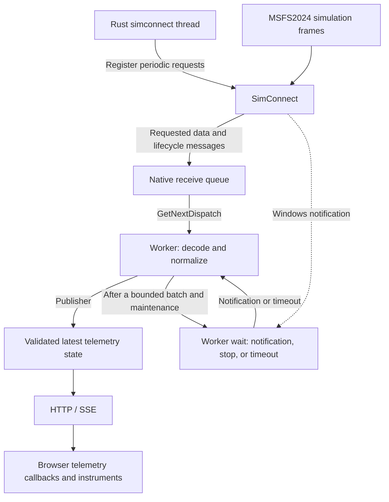

# SimConnect integration

User-aircraft flight instrument reception with optional diagnostics.

## Requirements

| Requirement | Contract |
| --- | --- |
| Runtime | Windows x64 MSVC. Use the [development environment](../../CONTRIBUTING.md#environment-setup) |
| DLL | Official x64 `SimConnect.dll`, obtained separately |
| Build | No SDK headers, import library, or installed simulator required |
| Acquisition | One native worker in the provider module within the existing Rust package. Publish normalized telemetry through the caller-owned channel |
| Telemetry | Existing [states, validity, and freshness](../telemetry-contract.md#freshness-and-status) |
| Scope | Standard aircraft attitude and available optional instrument data through the same HTTP/SSE and browser contract as Demo. Optional values are validated independently within one grouped sample |
| Distribution | Establish redistribution rights before distributing SDK artifacts. Runtime DLL loading does not establish permission |
| Repository | No SDK files, installation paths, or generated diagnostics in Git |

## Usage

### Run a session

1. Place the official `SimConnect.dll` and the validated `default.json` beside the executable.
   For Cargo runs, use the applicable Cargo output directory.
2. From the repository root, start the application:

   ```powershell
   cargo run --locked --release --bin msfs2024-artificial-horizon -- --source SimConnect.dll --log ".local\simconnect-sessions\flight.jsonl"
   ```

3. Check the console for the selected DLL and connection status.
   An active, unpaused flight produces `State: live` after a new sample passes availability checks.
4. Open the printed HTTP URL. For phone access, use the [private LAN setup](../../README.md#use-your-phone) with `--source SimConnect.dll`.
5. Press `Ctrl+C` to close HTTP clients and wait for native reception to stop.

For a DLL in another directory, provide its absolute path:

```powershell
$simconnectDll = Read-Host 'Absolute path to the official x64 SimConnect.dll'
cargo run --locked --release --bin msfs2024-artificial-horizon -- --source "$simconnectDll" --log ".local\simconnect-sessions\flight.jsonl"
```

### Command-line options

| Option | Behavior |
| --- | --- |
| No source option or `--source demo.dll` | Project-owned Demo DLL with HTTP/SSE |
| `--source SimConnect.dll` | Native acquisition with HTTP/SSE and available flight instruments |
| `--listen-address`, `--port` | HTTP settings for either source. Defaults are `127.0.0.1` and `8080` |
| `--scenario <file>` | Required Demo-only JSONL file, absolute or relative to the working directory |
| `--sse-interval-ms <ms>` | Ordinary SSE period from 1 through 1431655764 ms; default 500 ms |
| `--simconnect-interval <frames>` | Raw `SIM_FRAME` interval from 0 through 4294967295, inclusive; default 0 |
| `--log <file>` | Optional exact JSONL destination, absolute or relative to the working directory |
| `--help`, `--version` | Information without opening a DLL or log |
| `stop` on standard input | A line containing `stop` requests coordinated shutdown |
| `Ctrl+C` | Controlled shutdown that waits for the native worker |

The CLI applies these restrictions:

* `--log` is available for either source. `--scenario` is required for Demo and rejected for SimConnect.
* Invalid HTTP settings, frame intervals, and relative DLL paths containing directories are rejected before starting components.
* Legacy `--simconnect`, `--dll`, and source aliases are unsupported.
* Log filenames distinguish scenarios. The application does not interpret them as metadata.

### DLL selection and errors

| Property | Behavior |
| --- | --- |
| Default location | Beside the EXE, independent of the working directory |
| Search | No `PATH`, working-directory, or SDK search. No fallback after explicit selection |
| Dependencies | Selected DLL directory and Windows system directory only |
| Errors | Missing DLL, incompatible architecture, or missing exports stop startup before HTTP binds. A worker load failure, including a missing dependency, stops acquisition while HTTP remains available |
| Missing default DLL | Place it beside the EXE or select an absolute `--source` path |
| Console | DLL selection, connections, state changes, errors, and shutdown, including without logging |

## Public API

The `providers::simconnect` module exports the acquisition interface independently of HTTP. Demo playback also requires the host executable to pass `--scenario` in its process arguments.

| Interface | Contract |
| --- | --- |
| `SimConnectConfig` | Optional `dll` and `log` paths, and the raw native `interval`; Demo requires a `scenario` path. The default DLL is adjacent `demo.dll` |
| `resolve_dll(override_path)` | Return the selected path or `SimConnectError`. Validate path syntax without loading the DLL |
| `run(config, publisher, shutdown)` | Consume a caller-supplied `Publisher` whose source matches the selected DLL. Await caller-owned shutdown with output `io::Result<()>` and return `RunReport` |
| `RunReport::result` | Acquisition outcome as `Result<(), SimConnectError>` |
| `RunReport::diagnostics` | Independent `DiagnosticStatus`: disabled, completed, or failed |
| `SimConnectError` | Configuration, I/O, native, telemetry, or worker-panic failure |

The provider API preserves these boundaries:

* The provider creates no hidden telemetry channel and never starts HTTP.
* Configuration carries an optional Demo scenario path for source validation and log protection, but no HTTP settings. The Demo DLL reads the scenario path from the process arguments; callers using Demo must pass the same path in `--scenario`.
* DLL resolution uses the same executable-relative default for library and CLI calls, before opening diagnostics or loading native code.
* Dropping the running future signals worker cancellation. Normal shutdown also waits for the worker and reports cleanup results.
* A permanently blocked native call has no guaranteed completion deadline.

Application startup and source-failure isolation follow the [application lifecycle](../architecture.md#application-lifecycle).

## Runtime and resource lifecycle

The provider uses minimal manual bindings and runtime DLL loading within the existing Rust package.

| Decision | Scope |
| --- | --- |
| [ADR 0006](../adr/0006-simconnect-manual-ffi.md) | Binding, loading, and publication |
| [ADR 0007](../adr/0007-application-composition.md) | Composition, source-failure isolation, and shutdown |

### Application availability

The application starts components in this order:

1. Validate configuration and load the adjacent mapping.
2. Inspect the DLL file as an x64 PE image and validate required named export-table entries without loading it; reject files larger than 64 MiB. The worker performs authoritative loading and export resolution.
3. Create the waiting telemetry channel and bind HTTP. A busy port prevents acquisition from starting.
4. Start the producer. Its worker loads and initializes the DLL, resolves dependencies, and owns native calls.

HTTP does not wait for worker loading or simulator readiness.

| Condition | Application behavior |
| --- | --- |
| Simulator absent or disconnected | HTTP serves unavailable data while the existing provider retries |
| Producer exits or panics | Existing SSE streams stay open. New clients receive `disconnected` |
| Missing DLL, invalid image, or missing export | Startup fails before HTTP binds |
| Worker DLL load or dependency failure | HTTP stays available. Console diagnostics identify the failure without Demo fallback |
| Caller-selected shutdown or HTTP failure | Signal both components and wait for their results. HTTP failure returns an application error |

| Output | Contract |
| --- | --- |
| Console diagnostics and optional log | Contain detailed source errors |
| SSE | Current telemetry schema, including the configured SSE period |
| `/health` | HTTP liveness, independently of simulator availability |

### Reception and resource ownership

One native worker owns all SimConnect calls. Its [reading loop](#reading-from-simconnect) registers periodic delivery and drains received messages.

| Operation | Behavior |
| --- | --- |
| Retry | Interruptible waits of 1, 2, 4, 8, then at most 10 seconds |
| Source loss | No automatic switch to demo |

Normal shutdown uses this order:

1. Stop reception.
2. Close the native connection.
3. Release notification handles and the DLL.
4. Join the worker.

Cleanup preserves these limits:

* A failed native close retains the DLL mapping and notification handle until exit because native code might still use them.
* Cleanup records describe attempted paths. Inspect the final outcome and errors.

## Reading from SimConnect

The dedicated Rust thread named `simconnect` registers periodic data requests and reads the native message queue.
SimConnect supplies messages for those requests. The worker does not issue a new flight-data request for every queue read.



The diagram separates native acquisition from HTTP delivery and browser callbacks:

* The native worker owns acquisition, decoding, normalization, and publication.
* HTTP reads the shared telemetry state independently of the worker.
* Browser callbacks handle SSE samples. They do not call SimConnect or control its native dispatch loop.

### Reading sequence

1. Open the native connection and configure data definitions and lifecycle notifications.
2. Register each configured variable under one definition, then request the complete definition once through `SimConnect_RequestDataOnSimObject` with `PERIOD_SIM_FRAME`.
3. Read queued messages through `SimConnect_GetNextDispatch`, checking cancellation before each read.
4. Decode each message, record its monotonic receive time, and update instrument observations or source lifecycle state.
5. Cache eligible normalized telemetry through the caller-owned `Publisher`, preserving acquisition timestamps; ordinary SSE delivery follows its shared schedule.
6. After at most 128 messages, evaluate expiry, periodic diagnostics, system-state queries, and the silence watchdog.
7. Wait for a Windows notification, cancellation, or a 50 ms timeout. Resume queue reading after notification or timeout.

An empty queue ends the current batch early. Cancellation exits reception and starts the [shutdown sequence](#reception-and-resource-ownership).

### Delivery frequency and loop timing

| Operation | Frequency or trigger |
| --- | --- |
| Grouped delivery | Requested with `PERIOD_SIM_FRAME` and the configured raw interval, without `CHANGED`. Equal values remain eligible for delivery |
| Native queue reads | Repeated within each batch, up to 128 messages or until the queue is empty |
| Wait between batches | Notification or cancellation can wake the worker before the 50 ms timeout |
| Freshness evaluation | After message processing and between batches. The 50 ms timeout provides checks during quiet periods |
| System-state queries | Initial queries during configuration, then every 5 seconds while the loop runs |
| Diagnostic summary | Every second while the loop runs |
| Silence watchdog | Reconnect after 15 seconds without packets |

The interval counts simulation-frame events, not milliseconds. A bounded official-DLL observation found intervals 0 and 1 delivered once per separate interval-zero reference packet, and interval 2 once per two reference packets. That reference is another request rather than an independent simulator frame event. A large interval can leave the sample stale between packets: the source expires the whole sample after 1.5 times the SSE period, and IAS trend history resets at a gap of 500 ms or more.

> The 50 ms wait timeout is not a fixed 20 Hz acquisition rate. Data delivery follows simulator frames and native queue availability.
> Processing time and scheduling can delay loop work. These intervals are not hard real-time guarantees.

### Requirements and limits

* Keep every SimConnect call on the single native worker.
* Bound dispatch batches so continuous traffic cannot starve cancellation, expiry, state queries, or diagnostic flushing.
* Preserve each eligible acquisition's original receive time, including unchanged values.
* Do not renew sample freshness from cached values, system-state queries, or wakeups.
* Apply each structurally valid grouped sample atomically. Invalid optional values are omitted without discarding valid attitude or other values.
* Treat an empty dispatch or `E_FAIL` alone as insufficient evidence of disconnection.
* Treat the silence watchdog as a reconnect trigger, not proof of native connection loss.
* Do not promise a shutdown deadline when a native call is permanently blocked.

## Common native consumer

The accepted [native Demo decision](../adr/0010-native-demo.md) is implemented. The Demo DLL and official DLL use the same receiver, decoder, lifecycle gates, Publisher, and HTTP/SSE path. Source identity is selected before channel creation and stays Demo or SimConnect; a basename identifies selection, not authenticity. The Demo DLL reads its scenario from the host process arguments during Open.

### Used API and evidence

The current receiver uses Windows x64 C ABI and packed receive layouts derived from SDK 1.8.1 headers. The eight exact exports are `SimConnect_Open`, `SimConnect_Close`, `SimConnect_GetNextDispatch`, `SimConnect_AddToDataDefinition`, `SimConnect_RequestDataOnSimObject`, `SimConnect_SubscribeToSystemEvent`, `SimConnect_RequestSystemState`, and `SimConnect_GetLastSentPacketID`. Official API definitions document those interfaces; the manually declared layouts and their emulator implementation require independent header and runtime verification. The [definition API](https://docs.flightsimulator.com/msfs2024/retail/programming-apis/simconnect/api-reference/events-and-data/simconnect_addtodatadefinition/) documents FLOAT64 and units. All current fields request FLOAT64, including Bool. The SDK permits nonzero Bool true, including -1; `AUTOPILOT AVAILABLE` treats a received finite nonzero value as true.

The delivered mapping registers pitch and bank in radians and includes 17 optional inputs. The ordered configuration determines the response layout. On 2026-11-14, an official-DLL baseline observed all 19 inputs separately, and a grouped capture observed finite values for all 19 in 996 active valid packets. The two captures differed in heading and selected heading, which limits their comparability. The caller owns definition, request, event, and query IDs and field order; the DLL must route and encode those supplied values, not hard-code the current IDs. Current requests use user-aircraft proxy, `SIM_FRAME`, flags 0, origin 0, the configured interval, and limit 0. The [request API](https://docs.flightsimulator.com/msfs2024/retail/programming-apis/simconnect/api-reference/events-and-data/simconnect_requestdataonsimobject/) distinguishes these options from change-only requests. Other request modes are outside this used subset until implemented and verified.

The following evidence classifications apply separately to each part of the used API. Header-derived declarations are current-consumer evidence until an independent comparison with the target SDK header and runtime.

| Item | Independent evidence and remaining verification |
| --- | --- |
| `SimConnect_Open` | [Open reference](https://docs.flightsimulator.com/msfs2024/retail/programming-apis/simconnect/api-reference/general/simconnect_open/) documents the interface and notification handle. Compare the x64 declaration and notification behavior against the target header and runtime |
| `SimConnect_Close` | [Close reference](https://docs.flightsimulator.com/msfs2024/retail/programming-apis/simconnect/api-reference/general/simconnect_close/) documents the interface. Compare the x64 declaration and cleanup behavior against the target header and runtime |
| `SimConnect_GetNextDispatch` | [Dispatch reference](https://docs.flightsimulator.com/msfs2024/retail/programming-apis/simconnect/api-reference/general/simconnect_getnextdispatch/) documents the interface and library-owned buffer. Compare declaration, empty result tuple, and memory lifetime against target header and runtime |
| `SimConnect_AddToDataDefinition` | [Definition reference](https://docs.flightsimulator.com/msfs2024/retail/programming-apis/simconnect/api-reference/events-and-data/simconnect_addtodatadefinition/) documents definition arguments and FLOAT64. Compare declaration and exact pair acceptance against target header and runtime |
| `SimConnect_RequestDataOnSimObject` | [Request reference](https://docs.flightsimulator.com/msfs2024/retail/programming-apis/simconnect/api-reference/events-and-data/simconnect_requestdataonsimobject/) documents request IDs, periods, flags, origin, interval, and limit. Verify current `SIM_FRAME`, flags 0, origin 0, configured interval, limit 0, and user-aircraft proxy against the target runtime |
| `SimConnect_SubscribeToSystemEvent` | [Event reference](https://docs.flightsimulator.com/msfs2024/retail/programming-apis/simconnect/api-reference/general/simconnect_subscribetosystemevent/) documents subscriptions. Verify `Sim`, `Pause_EX1`, and `FlightLoaded` delivery against the target runtime |
| `SimConnect_RequestSystemState` | [State reference](https://docs.flightsimulator.com/msfs2024/retail/programming-apis/simconnect/api-reference/general/simconnect_requestsystemstate/) documents queries. Verify `Sim` and `FlightLoaded` response shapes and IDs against the target runtime |
| `SimConnect_GetLastSentPacketID` | [Packet ID reference](https://docs.flightsimulator.com/msfs2024/retail/programming-apis/simconnect/api-reference/debug/simconnect_getlastsentpacketid/) documents correlation. Verify declaration and association against target header and runtime |
| Packed receive layouts | Current consumer assumes packed `RECV`, exception, open, event, filename, system-state, and simobject-data layouts. Independently compare size, offsets, packing, and variable payload bounds with target SDK headers; exercise each used shape with an independent client |
| Grouped definition | Configuration determines order, units, and types. The observed FLOAT64/FLOAT32 and three-FLOAT32 packets cover only those layouts; other mixed layouts remain unverified |

### Native field catalog

`C` means a current-consumer compatibility assumption for the exact name, index, unit, and FLOAT64 request in that row. The consumer uses it, but this classification does not establish the exact combination independently. Before claiming SDK compatibility, check each `C` pair against its per-variable SDK entry, unit conversion rules, and the target runtime with an independent client. Record unsupported or ambiguous pairs individually. The SDK's [variable index](https://docs.flightsimulator.com/msfs2024/retail/programming-apis/simvars/simulation-variables/) locates the relevant variable pages. Aircraft availability remains a separate runtime question.

| Native SimVar | Requested unit | Consumer meaning | Evidence classification |
| --- | --- | --- | --- |
| PLANE PITCH DEGREES | radians | Primary native pitch, with existing sign conversion | C |
| PLANE BANK DEGREES | radians | Primary native bank, with existing sign/wrap conversion | C |
| AIRSPEED INDICATED | knots | IAS and existing derived acceleration | C |
| AIRSPEED TRUE | knots | TAS | C |
| GROUND VELOCITY | knots | GS | C |
| INDICATED ALTITUDE:1 | feet | Barometric altitude | C; indexed spelling unverified |
| KOHLSMAN SETTING HG:1 | inHg | Numeric BARO after current conversion | C; index independently documented |
| VERTICAL SPEED | feet per minute | VSI | C |
| PLANE HEADING DEGREES MAGNETIC | degrees | Heading | C |
| TURN COORDINATOR BALL | position 128 | Ball, divided by 127 in the current consumer | C |
| TURN INDICATOR RATE | degrees per second | Turn rate | C |
| DESIGN SPEED VS0 | knots | Optional VS0 | C |
| DESIGN SPEED VS1 | knots | Optional VS1 | C |
| DESIGN SPEED MIN ROTATION | knots | Optional VR reference | C |
| AIRSPEED BARBER POLE | knots | Independent dynamic redline | C |
| AUTOPILOT AVAILABLE | bool, FLOAT64 representation | Target availability gate | C |
| AUTOPILOT HEADING LOCK DIR:0 | degrees | Selected heading | C; indexed spelling unverified |
| AUTOPILOT ALTITUDE LOCK VAR:0 | feet | Selected altitude | C; indexed spelling unverified |
| AUTOPILOT ALT RADIO MODE | bool, FLOAT64 representation | Barometric/radio target gate | C |


The following independent references qualify individual indexed names:

* `KOHLSMAN SETTING HG:1` is documented as the first altimeter.
* `INDICATED ALTITUDE:1` is a current-consumer compatibility assumption: the inspected SDK example uses the unindexed name.
* Both `:0` autopilot target reads are compatibility assumptions: slot documentation describes slot 0, but the exact indexed reads are not established by the inspected variable tables.

The [autopilot variable reference](https://docs.flightsimulator.com/msfs2024/retail/programming-apis/simvars/aircraft-simvars/aircraft-autopilot-and-assistant-variables/), [aircraft system variables](https://docs.flightsimulator.com/msfs2024/retail/programming-apis/simvars/aircraft-simvars/aircraft-system-variables/), and [native units](https://docs.flightsimulator.com/msfs2024/retail/programming-apis/simvars/simulation-variable-units/) are independent references for the relevant catalog entries. Exact field/unit pairs beyond the stated indexed gaps still require per-variable verification; the current table is consumer evidence rather than a blanket SDK certification.

Documentation of a base name or unit is not proof that each aircraft supplies it. Test the assumptions against the target SDK and simulator before claiming compatibility. An emulator that accepts the same assumptions is not an independent oracle.

The SDK's [unit list](https://docs.flightsimulator.com/msfs2024/retail/programming-apis/simvars/simulation-variable-units/) lists `feet/minute` and `ft/min`, while its [panel XML example](https://docs.flightsimulator.com/msfs2024/retail/content-configuration/modular-simobjects/aircraft/instruments/panel-xml-logic-elements/) pairs `VERTICAL SPEED` with `feet per minute`. The baseline official SimConnect session accepted the latter spelling. This does not independently establish every SDK interface's accepted spellings.

The fictional full VFE/VNO/VNE and VX/VY/VG profile is not generated through private SimVars.
Keep independent browser/presentation fixtures for those existing supported display fields.
Do not remove display capability because the Demo source becomes narrower.


### Dispatch and error limits

The [dispatch API](https://docs.flightsimulator.com/msfs2024/retail/programming-apis/simconnect/api-reference/general/simconnect_getnextdispatch/) describes library-owned buffers and an empty-queue `SIMCONNECT_RECV_ID_NULL` message. It does not establish the complete empty-queue HRESULT, pointer, and length tuple. On 2026-11-08, an independent client observed `E_FAIL`, a null pointer, and length `0` after draining the official DLL with MSFS 2024 in flight; Demo returned the same tuple. This observation does not prove that every `E_FAIL` means an empty queue. The receiver currently treats `E_FAIL` as no packet. Notification, returned-memory lifetime, missed-frame and queue-overflow behavior remain separate verification concerns. Generate packets independently of dispatch; queued contents do not change when consumed late. Bound resources and do not silently discard lifecycle transitions.

Immediate HRESULT failures and asynchronous exception packets are distinct. A definition or grouped request failure terminates the acquisition session. Transient connection loss follows the retry policy. Terminal runtime errors leave HTTP available; missing local configuration, a missing DLL, an invalid image, or a missing export fails preflight before HTTP starts. Injected Demo failures do not establish that the official DLL emits the same error. Demo scenario validation failure occurs during Open and leaves HTTP available.

The following outcomes describe the current consumer and supervisor, based on static source analysis. They are not observed SDK error guarantees.

| Trigger | Current outcome |
| --- | --- |
| Demo Open returns `0xA0040001` | Terminate the producer; HTTP remains available |
| Demo dispatch reports scenario error `0xA0040001` | Terminate the producer; HTTP remains available |
| Other Open failure or QUIT | Retry with bounded backoff after applicable cleanup; HTTP remains available |
| Definition or grouped request failure, or any nonzero exception | Terminate acquisition and publish disconnected before cleanup; HTTP remains available |
| Required initial definition, subscription, query, or request failure | Terminate the producer; HTTP remains available |
| Later system-state query HRESULT or non-`E_FAIL` dispatch failure | Reconnect after successful cleanup; HTTP remains available |
| Failed send-ID lookup | Terminate acquisition rather than guessing correlation |
| Invalid native layout, uncorrelated exception, or Close failure | Terminate the producer; HTTP remains available. Close failure retains native mapping and notification ownership conservatively until process exit |
| Unknown message or mismatched grouped routing | Ignore unsupported message IDs; terminate on a mismatched grouped response |
| Total transport silence | The watchdog reconnects; primary data becomes stale first |
| Invalid primary value | Publish invalid state; recovery requires a new eligible sample |
| HTTP bind or application infrastructure failure | Coordinate shutdown and return an application error |

### Staged Demo fault coverage

The selected Demo subset and deferred mechanisms are distinct from simulator evidence:

| Used export or boundary | Demo fault coverage | Deferred or separately tested behavior |
| --- | --- | --- |
| `SimConnect_Open` | One-based injected HRESULT; a later Open can recover | Other Open result shapes, including null success handles |
| `SimConnect_AddToDataDefinition` | One-based HRESULT with optional native-name/unit selector; correlated exception using the actual sent packet ID | Other error channels |
| `SimConnect_SubscribeToSystemEvent` | One-based injected HRESULT | Name-specific selectors and asynchronous errors |
| `SimConnect_GetNextDispatch` | Timed owned raw bytes with bounded advertised length; the observed official empty-queue tuple matches Demo | Injected HRESULT, null dispatch, and behavior in other SDK/runtime conditions |
| `SimConnect_RequestDataOnSimObject` | One-based HRESULT with optional single-field selector; correlated exception using the actual sent packet ID | Other request modes |
| `SimConnect_RequestSystemState` | One-based HRESULT and bounded transport silence | Other system-state requests |
| `SimConnect_GetLastSentPacketID` | One-based HRESULT; failed lookup terminates setup | Other correlation failures |
| `SimConnect_Close` | One-based HRESULT; failed Close stops the emitter and retains native ownership | Further cleanup failure shapes |
| Invalid numeric data, unknown IDs, and malformed shapes | Decoder/normalization tests and owned raw-packet scenarios | Other malformed shapes and host-level memory faults |
| Loader, diagnostics, and host failures | Existing launch, journal, and supervision tests exercise selected cases | Missing host API and worker panic seams; no fictional native operation is added |

The [fault scenarios](demo-scenarios.md) isolate recoverable and terminal producer outcomes. Their tests distinguish source failure from HTTP and process liveness. The observed empty-queue tuple does not establish that every SDK `E_FAIL` has that cause.

## Telemetry acquisition and availability

### Attitude and freshness

Attitude acquisition uses these conventions:

* Register periodic delivery of `PLANE PITCH DEGREES` and `PLANE BANK DEGREES` as `FLOAT64` radians using `PERIOD_SIM_FRAME`, without `CHANGED`.
* Use the [native radian unit](https://docs.flightsimulator.com/msfs2024/retail/programming-apis/simvars/aircraft-simvars/aircraft-miscellaneous-variables/) despite the variable names.
* Negate both signs, convert locally to degrees, and wrap bank to the [telemetry range](../telemetry-contract.md#fields-and-conventions).
* Reject invalid or nonfinite primary input. Do not clamp it.

| Output | Convention |
| --- | --- |
| `pitch_deg` | Finite degrees, positive nose up, in `[-90, 90]` |
| `roll_deg` | Finite degrees, positive right wing down, in `[-180, 180)` |

Availability follows these rules:

* Live requires running `Sim`, a loaded flight, known zero `Pause_EX1` flags, and a fresh valid sample.
* No single event or nonempty filename establishes readiness.
* Pause, invalid data, disconnect, and flight or simulator transitions invalidate retained attitude.
* Resume and a new flight require a new valid sample.
* Cache every eligible acquisition with its original receive time, including identical angles. The shared schedule publishes live snapshots.
* Cached values, heartbeats, and system-state queries never refresh age.
* Evaluate freshness during the [reading loop](#delivery-frequency-and-loop-timing), including quiet-period timeout checks. Unavailable publication carries no attitude.
* Samples can continue during pause. Ordinary pause and menu can share flags, so the flags do not uniquely identify the UI phase.

| State | Meaning |
| --- | --- |
| `waiting` | Incomplete or inactive lifecycle, or a new sample required |
| `live` | Valid sample from an active, unpaused flight |
| `paused` | Nonzero pause flags, including unknown bits |
| `stale` | No new valid sample for 1.5 times the SSE period while expecting live data |
| `disconnected` | Native connection unavailable |
| `invalid` | Input fails normalization or validation |

### Optional instrument observations

The native worker requests these optional observations:

| Observation | Source units or selection |
| --- | --- |
| IAS, TAS, GS | Knots |
| KOHLSMAN pressure, indicated altitude | inHg and feet, respectively, from altimeter index 1 |
| VSI | Feet per minute |
| Magnetic heading | Degrees |
| Slip/skid ball position | Position |
| Turn rate | Degrees per second |
| Autopilot targets | Active slot 0. Target visibility does not require the autopilot master to be engaged. Radio-referenced altitude targets are omitted |

> The cockpit control corresponding to altimeter index 1 depends on the aircraft and requires live verification.

Optional fields follow these availability rules:

* A valid packet replaces all optional observations together. Each optional value is validated separately and an invalid value is omitted.
* The complete sample expires after 1.5 times the SSE period without an accepted packet. Pauses, flight changes, and reconnect clear cached values.
* Invalid attitude makes the complete sample unavailable; a later valid packet can recover.

Speed profiles have these source limits:

* VS0, VS1, project minimum rotation, and current redline are independently available. Other thresholds and references remain absent unless their exact standard source is established.
* No aircraft configuration reader or addon-specific avionics bridge is provided.

| Observation or reference | Interpretation limit |
| --- | --- |
| Minimum rotation | Project reference, not a Vr calculated by an FMS based on weight and flap position |
| General climb speed | Not substituted for Vy |
| Current flap limits | Not substituted for fixed VFE |
| Dynamic redline | Not fixed VNE |

IAS trend uses a bounded 0.5-second window of valid worker acquisitions and their monotonic receive times.
The trend describes knots per real second, including when simulation speed differs from real time.

Trend freshness and history follow these rules:

* Acceleration expires after 500 ms without a new IAS sample, and IAS trend history resets at a gap of 500 ms or more. IAS shares the complete sample's freshness deadline.
* The history resets after invalid input, a stale gap, pause, or flight change.

## Diagnostic logging

| Property | Behavior |
| --- | --- |
| Destination | Append to the exact file, creating missing parent directories |
| Existing data | Preserve previous records and allow only one writer |
| Interrupted tail | Retain the partial line and separate it from the next session. The partial line is not a valid record |
| Protected files | Reject the selected DLL, executable, and mapping as destinations |
| Record identity | Unique `session_id` per run and per-session `record` numbering |
| Time | Monotonic `elapsed_us`, UTC reference in `started_unix_ms`, strings for some integers to preserve precision |
| Nonfinite values | JSON-compatible value, classification, and bit-pattern fields |
| Flush | Significant events, at least once per second while recording, and shutdown |
| No logging | No journal, diagnostic environment collection, or raw-record formatting |

The application places no size limit on the journal; it can grow throughout a requested logging session.

Diagnostic failures remain independent of acquisition:

| Condition | Result |
| --- | --- |
| Open or initial write failure | Abort acquisition before opening the native connection. HTTP remains available |
| Later write or flush failure | Disable diagnostics, continue acquisition and cleanup, warn immediately and at shutdown |
| Missing `session_end` | Unconfirmed termination |
| Final result | `DiagnosticStatus` distinguishes disabled, completed, and failed logging independently of the native outcome |

### Grouped definition and payload

The executable loads the mandatory `default.json` beside it before acquisition. It remains fixed until restart and is reused after reconnect. Missing, unreadable, or invalid configuration fails startup. Each ordered mapping requires `field`, `simvar`, `unit`, and `type`. Target fields must appear exactly once; units must have a defined conversion for that field. Supported exact SDK type names are `SIMCONNECT_DATATYPE_INT32`, `SIMCONNECT_DATATYPE_INT64`, `SIMCONNECT_DATATYPE_FLOAT32`, and `SIMCONNECT_DATATYPE_FLOAT64`. Unsupported types, duplicate or missing fields, unknown fields, and malformed entries are errors.

The delivered configuration is:

```json
{
  "mappings": [
    {
      "field": "pitch",
      "simvar": "PLANE PITCH DEGREES",
      "unit": "radians",
      "type": "SIMCONNECT_DATATYPE_FLOAT64"
    },
    {
      "field": "roll",
      "simvar": "PLANE BANK DEGREES",
      "unit": "radians",
      "type": "SIMCONNECT_DATATYPE_FLOAT64"
    },
    {
      "field": "indicated_airspeed",
      "simvar": "AIRSPEED INDICATED",
      "unit": "knots",
      "type": "SIMCONNECT_DATATYPE_FLOAT64"
    },
    {
      "field": "true_airspeed",
      "simvar": "AIRSPEED TRUE",
      "unit": "knots",
      "type": "SIMCONNECT_DATATYPE_FLOAT64"
    },
    {
      "field": "ground_speed",
      "simvar": "GROUND VELOCITY",
      "unit": "knots",
      "type": "SIMCONNECT_DATATYPE_FLOAT64"
    },
    {
      "field": "barometric_altitude",
      "simvar": "INDICATED ALTITUDE:1",
      "unit": "feet",
      "type": "SIMCONNECT_DATATYPE_FLOAT64"
    },
    {
      "field": "baro_setting",
      "simvar": "KOHLSMAN SETTING HG:1",
      "unit": "inHg",
      "type": "SIMCONNECT_DATATYPE_FLOAT64"
    },
    {
      "field": "vertical_speed",
      "simvar": "VERTICAL SPEED",
      "unit": "feet per minute",
      "type": "SIMCONNECT_DATATYPE_FLOAT64"
    },
    {
      "field": "heading",
      "simvar": "PLANE HEADING DEGREES MAGNETIC",
      "unit": "degrees",
      "type": "SIMCONNECT_DATATYPE_FLOAT64"
    },
    {
      "field": "slip_skid",
      "simvar": "TURN COORDINATOR BALL",
      "unit": "position 128",
      "type": "SIMCONNECT_DATATYPE_FLOAT64"
    },
    {
      "field": "turn_rate",
      "simvar": "TURN INDICATOR RATE",
      "unit": "degrees per second",
      "type": "SIMCONNECT_DATATYPE_FLOAT64"
    },
    {
      "field": "vs0",
      "simvar": "DESIGN SPEED VS0",
      "unit": "knots",
      "type": "SIMCONNECT_DATATYPE_FLOAT64"
    },
    {
      "field": "vs1",
      "simvar": "DESIGN SPEED VS1",
      "unit": "knots",
      "type": "SIMCONNECT_DATATYPE_FLOAT64"
    },
    {
      "field": "rotation_speed",
      "simvar": "DESIGN SPEED MIN ROTATION",
      "unit": "knots",
      "type": "SIMCONNECT_DATATYPE_FLOAT64"
    },
    {
      "field": "maximum_airspeed",
      "simvar": "AIRSPEED BARBER POLE",
      "unit": "knots",
      "type": "SIMCONNECT_DATATYPE_FLOAT64"
    },
    {
      "field": "autopilot_available",
      "simvar": "AUTOPILOT AVAILABLE",
      "unit": "bool",
      "type": "SIMCONNECT_DATATYPE_FLOAT64"
    },
    {
      "field": "selected_heading",
      "simvar": "AUTOPILOT HEADING LOCK DIR:0",
      "unit": "degrees",
      "type": "SIMCONNECT_DATATYPE_FLOAT64"
    },
    {
      "field": "selected_altitude",
      "simvar": "AUTOPILOT ALTITUDE LOCK VAR:0",
      "unit": "feet",
      "type": "SIMCONNECT_DATATYPE_FLOAT64"
    },
    {
      "field": "autopilot_alt_radio_mode",
      "simvar": "AUTOPILOT ALT RADIO MODE",
      "unit": "bool",
      "type": "SIMCONNECT_DATATYPE_FLOAT64"
    }
  ]
}
```

The [definition API](https://docs.flightsimulator.com/msfs2024/retail/programming-apis/simconnect/api-reference/events-and-data/simconnect_addtodatadefinition/) registers each variable with the same definition ID. The [request API](https://docs.flightsimulator.com/msfs2024/retail/programming-apis/simconnect/api-reference/events-and-data/simconnect_requestdataonsimobject/) then requests that definition once using `SIM_FRAME`, flags 0, origin 0, the configured interval, and limit 0. These are setup calls; the former separate requests were also persistent, not resent every frame. Grouping fields of the same cadence reduces application messages and dispatch callbacks, but no CPU, IPC, network, or frame-time improvement has been measured.

An untagged response follows definition order and configured numeric widths. The decoder validates flags, count, entry metadata, and exact payload length before applying it. The SDK's managed-client guidance specifies sequential packing; a bounded official-DLL observation with FLOAT64 followed by FLOAT32 returned a 52-byte packet and count 2. A separate three-FLOAT32 mapping returned a 52-byte packet and count 3, distinguishing fields from rounded 8-byte units in that case. Other mixed layouts remain unverified. `TAGGED` instead sends datum IDs with values. With `CHANGED` and without `TAGGED`, a change to one member sends the whole definition. Unchanged values can then produce silence, so this receiver keeps flags 0 for freshness. `SIM_FRAME` follows simulation frames; `VISUAL_FRAME`, `SECOND`, and `ONCE` have different cadence semantics. Grouping by cadence is general API guidance; this application uses one group. Facility-data APIs, including `AddToFacilityDefinition`, are separate from aircraft SimVar requests.

A definition or request failure terminates acquisition, publishes `disconnected`, and requires investigation and restart. Transport loss, simulator quit, and the connection watchdog use bounded reconnect delays. A correlated registration exception identifies a mapping only when its send ID matches that registration; `dwIndex` is an API parameter index. Unknown IDs are not attributed to a field. A version mismatch reports the selected DLL identity and available SDK metadata on stderr even when logging is disabled. A structurally invalid packet terminates acquisition; invalid attitude publishes `invalid` and a later valid packet may recover. Empty dispatch does not establish disconnection. HTTP remains available after runtime acquisition failure. The observed grouped flight contained all 19 fields. Official behavior when a field is missing remains unverified.

### Record reference

| Records | Content |
| --- | --- |
| `session_start`, `environment`, `dll_identity` | Session configuration and identities |
| `definition_registration`, `grouped_request` | Mapping entries and sent-packet IDs |
| `dispatch`, `grouped_sample` | Owned decoded packets and values in canonical field order, with validation result. This order can differ from the mapping registration order |
| `native_error`, `native_exception` | Failure details and correlation when available |
| `state_transition`, `connection_lost`, `reconnect_wait` | State and recovery observations |
| `dispatch_summary`, `session_end` | Queue and cleanup observations |

### Diagnostic schema interpretation

Interpret recorded evidence according to its diagnostic schema:

| Diagnostic schema | Evidence interpretation |
| --- | --- |
| 1–3 | Candidate live states do not establish live telemetry publication |
| 2 | Cross-unit disagreements could invalidate samples. Account for this when interpreting recorded invalid states |
| 4 | Records identify enabled live publication, but do not journal every publication |
| 5 | Publication records identify the actual snapshot and sequence. Missing or interrupted records leave correlation incomplete |
| 6 | Grouped registrations and samples use the configured mapping; publication records remain transition-only |

## Testing

Select the shared testing procedure by purpose:

| Purpose | Procedure |
| --- | --- |
| Select checks for the change | [Validation scope matrix](../testing/index.md#validation-by-change-scope) |
| Run automated checks | [Automated commands](../testing/automated.md#automated-checks) |
| Record results and evidence limits | [Evidence procedure](../testing/evidence.md) |

### Automated checks

| Boundary | Coverage |
| --- | --- |
| Configuration | Source selection, DLL paths, CLI errors, Demo independence, HTTP settings for both sources |
| Application integration | Startup ordering, source-failure isolation, retained SSE, shutdown, multiple clients and attitude-only publication |
| Native data | ABI layout, payload decoding, normalization, rejected packets |
| Telemetry | New and equal acquisitions, original receive time, stale data, invalid input, lifecycle invalidation |
| Diagnostics and resources | Append sessions, writer exclusion, protected destinations, diagnostic failures, retry bounds, cancellation, cleanup |

### Bounded development observation

Build the complete application and prepare an output directory before recording. Start an active flight for SimConnect observations. The recorder requires Node.js and starts the supplied application; it does not control the simulator.

```powershell
cargo build --workspace --locked --release --target x86_64-pc-windows-msvc
Copy-Item default.json target/x86_64-pc-windows-msvc/release/default.json
New-Item -ItemType Directory -Force .local/live | Out-Null
$appExe = Join-Path $PWD 'target/x86_64-pc-windows-msvc/release/msfs2024-artificial-horizon.exe'
node tools/live/run.mjs --exe "$appExe" --url http://127.0.0.1:8080/api/v1/events --output .local/live/demo.jsonl --duration-seconds 30 --max-messages 1000 -- --source demo.dll --scenario demo-scenarios/demo-scenario.jsonl --listen-address 127.0.0.1 --port 8080
```

For SimConnect, provide the official x64 DLL path and choose a new telemetry output filename. Add `--log` after `--` to record application diagnostics in a separate file:

```powershell
$simconnectDll = Read-Host 'Absolute path to the official x64 SimConnect.dll'
node tools/live/run.mjs --exe "$appExe" --url http://127.0.0.1:8080/api/v1/events --output .local/live/flight.jsonl --duration-seconds 30 --max-messages 1000 -- --source "$simconnectDll" --log .local/live/simconnect.jsonl --listen-address 127.0.0.1 --port 8080
```

Options before `--` configure the recorder. Arguments after `--`, including `--log`, go to the application. The recorder writes the telemetry JSONL file, and the application appends diagnostic records to the JSONL file. Use a new telemetry filename for each run and distinct log filenames to distinguish sessions. Inspect and compare the files separately.

The output file is created exclusively. Each completed SSE data message is written as one line, without validating or changing its JSON. Multiple data lines in one event are joined with spaces; incomplete events are not written. A malformed payload remains in the file and may not be valid JSONL. Inspect the data separately; recording does not validate telemetry, readiness, or field availability. Demo data is not live evidence. Use the [desktop procedure](../testing/pfd.md#responsive-efi-layout-and-desktop-checks) separately for visual checks.

At least one limit is required. The duration begins when response headers arrive; the message limit counts completed SSE blocks containing data lines. When both are supplied, the first limit stops capture. All complete messages in the final received chunk are recorded, so the output may contain more messages than the limit. Ctrl+C cancels a capture.

The recorder retries the SSE connection for up to ten seconds while the application starts, then sends `stop` on standard input during cleanup. Choose an unused port: the recorder does not verify which process owns the endpoint. If the application does not exit in ten seconds, the recorder terminates that child and reports cleanup failure. Exit codes are `0` for a completed capture, `130` for cancellation with successful cleanup, and `1` for an operational or cleanup failure. A blocked native call has no guaranteed graceful deadline.

### Official-DLL smoke check

Run the optional official-DLL smoke check:

1. Set `$simconnectDll` to the official DLL's absolute path.
2. Close the simulator.
3. Run the check:

   ```powershell
   $env:SIMCONNECT_TEST_DLL = $simconnectDll
   cargo test --locked --test simconnect official_dll_stops_on_requested_shutdown_and_uses_caller_channel -- --ignored --nocapture
   Remove-Item Env:SIMCONNECT_TEST_DLL
   ```

The smoke check has these limits:

* It covers loading, unavailable connection attempts, and requested shutdown after 750 ms.
* It does not establish active-flight behavior. Rust layout tests alone do not prove SDK ABI compatibility.

### Repeatable simulator scenarios

Select manual checks only for a concrete change, contradiction, or additional claim:

| Scenario | Expected behavior or observation |
| --- | --- |
| Startup and reconnect | Unavailable startup, menu and loading, fresh active data, simulator restart, new samples after reconnect. No demo fallback |
| Attitude | Level, nose up and down, left and right bank, combined poses against the cockpit |
| Pause and flight change | Unavailable attitude during ordinary pause, Active Pause, and menu. New samples after resume or another flight |
| CPU or cancellation | Affected stable phase with or without logging, or the specific shutdown failure |

Use these evidence rules:

* Reuse existing results before requesting another run.
* Keep local logs, session IDs, versions, independent observations, and [build provenance](../testing/evidence.md#build-provenance). Runtime metadata alone does not establish a binary's source.
* Divide process CPU time by elapsed wall time for one logical CPU. State normalization across all logical CPUs.
* Use console observations without logging for connection, availability, and shutdown claims. Do not infer numerical angles.

### Integrated HTTP/SSE and device acceptance

Integrated acceptance follows these requirements:

* Use the final release artifact and the [real-device procedure](../testing/devices.md#real-phone-acceptance-procedure).
* Run the following scenarios separately on actual iOS Safari and Android Chrome.
* Keep receiver and local-publication evidence separate from these end-to-end results.

| Scenario | Expected result |
| --- | --- |
| Missing DLL or exports | Startup fails before HTTP binds; no Demo fallback |
| Level, nose up and down, left and right bank, combined poses | EFI orientation agrees with cockpit observations. Do not infer a precise angular accuracy claim |
| Ordinary pause, Active Pause, flight exit, restart | Unavailable attitude during loss. Recovery requires a new valid active sample |
| Two clients and a slow receiver | Both use one acquisition connection. A slow client does not delay the other or block reception |
| Producer termination after live data | Existing SSE stays open and old attitude clears. A new client receives the current unavailable state |
| Silence and invalid samples | `stale` or `invalid`, without frozen valid-looking attitude. Heartbeat does not renew freshness |
| Attitude-only live sample | Other EFI indications remain unavailable |
| Rotation, background, lock/resume, Wi-Fi recovery | Readable status and fresh-data recovery without reload or duplicate subscriptions |
| Ctrl+C with active clients | Client connections end and the port is reusable. Record native cleanup outcome separately |

Fault tests and acceptance records have these requirements:

* Use controlled producers for deterministic fault tests without changing the production source choices.
* Record the tested revision, binary and DLL identities, environment, exact inputs, observed behavior, and missing checks.

> Desktop fixture tests cannot certify the real simulator path or either mobile browser.

## Evidence and limitations

### Live-publication evidence

| Evidence or acceptance | Coverage or limit |
| --- | --- |
| #5 records | Cover the receiver and local publication. Do not establish the integrated HTTP/SSE-to-EFI path or actual behavior on iOS and Android. |
| Integrated simulator and mobile acceptance | Require separate runs against the final application artifact |

| Source | Purpose |
| --- | --- |
| [#5 acceptance record](https://github.com/LeszekKantorek/msfs2024-artificial-horizon/issues/5) | Tested environments and evidence limits |
| [ADR 0006](../adr/0006-simconnect-manual-ffi.md#live-publication) | Decision to enable live publication |

### Recorded evidence limits

The [validation evidence](https://github.com/LeszekKantorek/msfs2024-artificial-horizon/issues/5) has these limits:

| Area | Evidence limit |
| --- | --- |
| Compatibility | Tested setup only, not every aircraft, UI phase, or simulator and DLL version |
| Cockpit comparison | No certification of precise angles or independently timed readiness |
| Live publication | Automated regression tests cover live publication. Physical sessions using the waiting gate do not establish behavior with live publication enabled |
| Performance | Short active CPU observations, not a benchmark. Menu CPU and numerical shutdown latency are unmeasured |
| Other environments and interruption | Untested: clean machine without SDK, interruption during a blocked native call, independent OS unload verification |

## Rationale and regression lessons

| Decision | Reason |
| --- | --- |
| Native radians | Independent requested units do not guarantee simultaneous acquisition |
| Official grouped flight | All 19 default FLOAT64 fields had finite values in the bounded capture; heading differed from the baseline |
| Official missing-field behavior and other mixed-numeric layouts | Not yet verified; the two observed layouts are described in [grouped definition](#grouped-definition-and-payload) |
| Native bindings and ownership | Defined in [ADR 0006](../adr/0006-simconnect-manual-ffi.md) |
